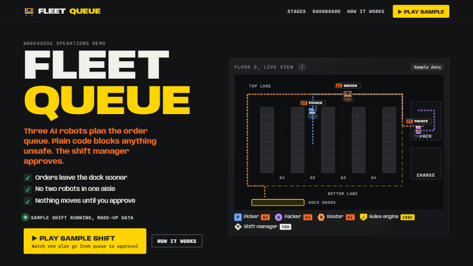
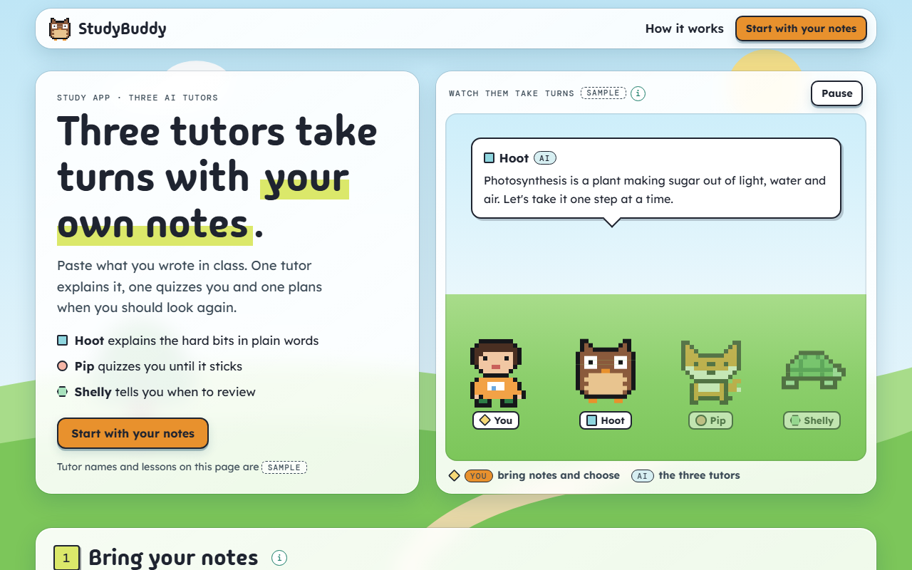
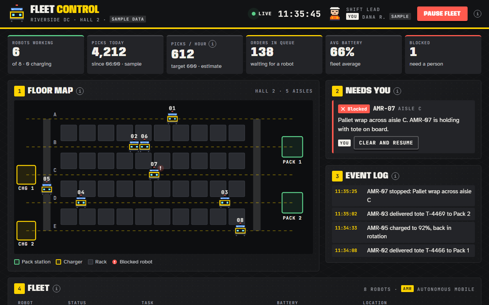
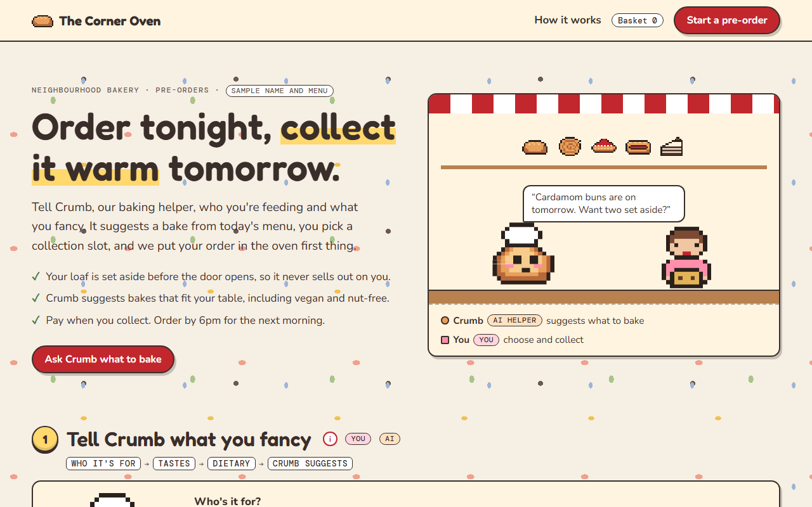
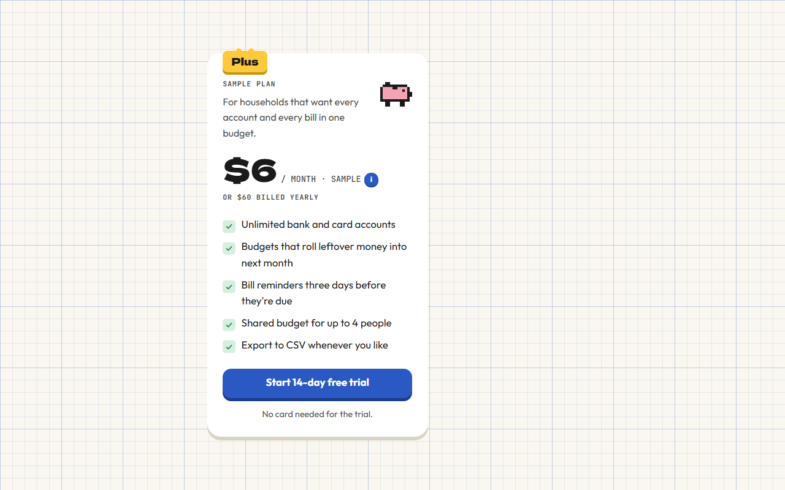

<p align="center"></p>

# 🧸 cutify-ui

**A Claude skill for cute, game-like web pages with pixel characters, story stages and motion that shows your product at work.**

[](https://slyf0xx97.github.io/cutify-ui/)
[](https://github.com/slyf0xx97/cutify-ui/releases/latest)


[](https://github.com/slyf0xx97/cutify-ui/actions)

<p><a href="https://donate.stripe.com/00w4gr2TU7wC52iaXf18c01"></a></p>

cutify-ui is an open-source [Claude skill](https://docs.claude.com/en/docs/agents-and-tools/agent-skills/overview). Ask Claude for a landing page, a product demo or a portfolio, and the skill gives it six themes, ready components and animation patterns to build from. It works in Claude Code, Claude.ai and the Claude API, and builds in React and Next.js or in plain HTML, CSS and SVG.

🌐 See all twelve examples in the [live gallery](https://slyf0xx97.github.io/cutify-ui/).

## Contents

<table>
<tr><th align="left">🚀 Start</th><th align="left">👀 Look</th><th align="left">🔧 Build</th><th align="left">📄 About</th></tr>
<tr><td valign="top"><a href="#%EF%B8%8F-install">Install</a><br><a href="#quickstart">Quickstart</a><br><a href="#-sample-prompts">Sample prompts</a></td><td valign="top"><a href="#-why-it-doesnt-look-ai-made">Why it doesn't look AI-made</a><br><a href="#-features">Features</a><br><a href="#%EF%B8%8F-gallery">Gallery</a><br><a href="#-themes">Themes</a></td><td valign="top"><a href="#-whats-inside">What's inside</a><br><a href="#-testing-and-validation">Testing and validation</a></td><td valign="top"><a href="#%EF%B8%8F-privacy-and-limits">Privacy and limits</a><br><a href="#-contributing">Contributing</a><br><a href="#-support">Support</a><br><a href="#-license">License</a></td></tr>
</table>

## 🛠️ Install

In Claude Code, paste this one line into the chat:

```
/plugin install cutify-ui --marketplace slyf0xx97/cutify-ui
```

For Cursor, Codex, Gemini CLI or another coding agent, run this one line in your terminal and pick your agent:

```bash
npx skills add slyf0xx97/cutify-ui
```

That's all. Ask for a cute landing page and your agent uses the skill on its own.

<details>
<summary>Claude.ai, the Claude API and older versions of Claude Code</summary>

- Claude.ai: download `cutify-ui.zip` from the [latest release](https://github.com/slyf0xx97/cutify-ui/releases/latest) and upload it under Settings → Capabilities → Skills.
- Claude API: upload the same zip with the Skills API and attach it to your requests.
- Claude Code older than 2.1.275: run `/plugin marketplace add slyf0xx97/cutify-ui`, then `/plugin install cutify-ui@cutify-ui`.

</details>

### Quickstart

Ask for a page in plain words. Claude picks a theme, tells you which one and builds it. If it reaches for another skill instead, start the prompt with "Use the cutify-ui skill." and it loads this one.

```text
Make a cute landing page for my study app with three AI tutors. Write it as a single index.html in the current folder.
```

```text
Build a dark control-room demo for our warehouse robots, with sample numbers. Write it as a single index.html in the current folder.
```

```text
Make a portfolio site for a made-up design student, with a pixel avatar that walks a trail as you scroll. Write it as a single index.html in the current folder.
```

```text
Just a Toy Box pricing card for my budgeting app, please. Write it as a single index.html in the current folder.
```

Works best with

- Opus 5.5 or Sonnet 5.5 for full pages. In Claude Code at the default effort, Opus took about 5 to 7 minutes a page. Higher effort may be worth trying for big pages with many sections.
- Sonnet 5.5 for a quick component. It built the pricing card in 44 seconds and stayed closest to the brief. Haiku 5.5 works too but follows the brief less closely.
- Python 3, so Claude can run `scripts/lint_page.py`. It needs only the standard library.
- A browser tool such as a Playwright MCP server, if you have one. Claude uses it to screenshot the page at 1440px and 390px and fix what it sees.

There's nothing else to install and no API key. Name a theme if you want a particular look, or ask for three directions to pick from.

## 🙅 Why it doesn't look AI-made

Pages that Claude designs on its own often look alike, because it falls back on the safest choice for every font, colour and layout. cutify-ui makes those choices before Claude writes any CSS:

- Each theme fixes exact fonts, hex colours and one kind of depth, so Claude never has to guess at "modern".
- The skill names the usual tells and tells Claude to avoid them: purple-to-blue gradients, soft-shadowed rounded cards everywhere, emoji as icons, a centred hero over three feature boxes, Inter as the headline font and lorem ipsum.
- Claude writes the real copy from your brief before the layout, and labels anything made up as "sample".
- If your project has a `taste.md` file of things you like and dislike, Claude reads it first and offers to add your reactions to it.
- Before showing you a page, Claude checks the draft against your brief and the list of tells, then screenshots it at 1440px and 390px.

## ✨ Features

In the order you'll meet them on a page:

| Area | What you get |
|---|---|
| 🎨 Themes | Six themes with their own fonts, palette and kind of depth: Glass, Apron, Picnic, Riso Club, Lantern Night and Toy Box |
| 🧺 Backdrops | 19 backgrounds in pure CSS or inline SVG, from gingham and riso grain to a starry dusk and 1-bit dither, with a guide to picking one |
| 🔤 Fonts | Ten font pairings, all under the SIL Open Font License, with notes on which faces stay readable at small sizes |
| 👾 Characters | Pixel sprites drawn as text grids that render as crisp SVG at any size, with single pixels that blink or wave |
| 🏷️ AI and You tags | A shape for each character, so nobody has to tell them apart by colour alone |
| 🗺️ Story stages | Numbered stages that walk a visitor through the product in order |
| ✈️ Routes | Sprites that follow a real drawn path with CSS `offset-path` |
| ⏯️ Animation patterns | Five ways to show a product at work, such as a story you can replay, a clock-driven simulation and a journey that follows your scroll |
| 🍬 Small interactions | Ten of them, including a ledge press, a peel corner, typing dots and confetti |
| 🧘 Reduced motion | Every animation stops for visitors who ask for reduced motion, and pauses when it's off screen |
| 💬 Tooltips | Open on hover, keyboard focus and tap, with labels screen readers can read |
| 🎮 Components | Buttons, pills, meters, number tiles, small SVG charts, native `<dialog>` modals and loading screens |
| ⚛️ React 19 | Typed components for React and Next.js: `PixelSprite`, `PixelIcon`, `Popup`, `WordTip`, `StageHeader` and `KindChip` |
| 🐍 Streamlit | Helpers for hosting the pages inside Streamlit and sending clicks back to Python |
| 🔎 Page linter | `scripts/lint_page.py`, which Claude runs on each page it builds to catch repainting animations, emoji icons, outside scripts and unlabelled sample data |

## 🖼️ Gallery

Claude built each example with the skill from a brief of a few sentences, then checked it in a browser at widths from 375px to 1440px. The first six briefs described only the product and its characters. The newer six also named a theme or palette, to show each one. Click a picture to open the page. The brief Claude got sits under each one, with a copy button.

<!-- GALLERY:START -->
<table>
<tr>
<td width="50%" valign="top">

<a href="https://slyf0xx97.github.io/cutify-ui/examples/studybuddy/"></a><br><b><a href="https://slyf0xx97.github.io/cutify-ui/examples/studybuddy/">StudyBuddy</a></b> (<a href="examples/studybuddy">source</a>)<br>Three AI tutors plan, quiz and check in. You approve the week.<br><sub>🪟 Glass, HTML</sub>

```text
StudyBuddy, an exam-prep app for university students. Three AI tutors: a Planner that builds a revision timetable, a Quizzer that writes practice questions, and a Coach that checks in on your mood. The student approves their weekly plan. Use the Glass (light) theme. A cute, friendly, game-like single-page landing site with animation that shows the tutors working together.
```

</td>
<td width="50%" valign="top">

<a href="https://slyf0xx97.github.io/cutify-ui/examples/fleet-queue/"></a><br><b><a href="https://slyf0xx97.github.io/cutify-ui/examples/fleet-queue/">Fleet Queue</a></b> (<a href="examples/fleet-queue">source</a>)<br>Warehouse robots plan the order queue, code blocks unsafe moves, a manager approves.<br><sub>🛫 Apron, HTML</sub>

```text
Fleet Queue, a warehouse operations demo. Three AI agents (Picker, Packer and Router robots) coordinate the order queue, a rules engine (plain code) blocks unsafe plans (aisle congestion, battery level, weight limits), and the shift manager approves the final plan. Apron (dark control-room) theme. Robots visibly move along drawn aisles, with a small before/after dashboard. All numbers are labelled sample data.
```

</td>
</tr>
<tr>
<td width="50%" valign="top">

<a href="https://slyf0xx97.github.io/cutify-ui/examples/sunday-spread/"></a><br><b><a href="https://slyf0xx97.github.io/cutify-ui/examples/sunday-spread/">Sunday Spread</a></b> (<a href="examples/sunday-spread">source</a>)<br>A Host and a Baker plan a potluck so nothing doubles up. You confirm the menu.<br><sub>🧺 Picnic, HTML</sub>

```text
"Sunday Spread", a potluck planner for friends. Two AI helpers: the Host, who suggests dishes so nothing doubles up and the meal is balanced, and the Baker, who scales recipes to the guest count. Guests claim dishes; you (the organiser) confirm the menu in a native <dialog>, with a confetti micro-interaction (and a reduced-motion fallback). Picnic theme (assets/picnic.css): gingham backdrop, Fredoka + Nunito + DM Mono, jam-jar-lid stage numbers, paper-tag tooltips. Only this cast (Host AI, Baker AI, You, plus guest avatars as simple pixel sprites); invent no other mechanics. Data is made up and labelled as sample.
```

</td>
<td width="50%" valign="top">

<a href="https://slyf0xx97.github.io/cutify-ui/examples/zine-night/"></a><br><b><a href="https://slyf0xx97.github.io/cutify-ui/examples/zine-night/">Zine Night</a></b> (<a href="examples/zine-night">source</a>)<br>The Curator draws a route through a 40-table zine fair. You star tables and print the map.<br><sub>🖨️ Riso Club, HTML</sub>

```text
"Zine Night", the page for a (made-up) indie zine fair with 40 tables. One AI helper, the Curator, builds a walking route through the tables from the topics you like; you star tables and approve your route, then get a printable map. Riso Club theme (assets/riso.css): newsprint + grain backdrop with a pink halftone fade behind the hero, Bricolage Grotesque + Rethink Sans + Space Mono, misregistered pink/blue double shadows, outlined stage numbers, a marquee strip divider, overprint (multiply) effects. Draw the fair floor as an SVG map and animate the route drawing itself (self-drawing line) and a pixel visitor walking it. Only this cast (Curator AI, You, simple pixel table-owner sprites); invent nothing else. All data made up and labelled sample.
```

</td>
</tr>
<tr>
<td width="50%" valign="top">

<a href="https://slyf0xx97.github.io/cutify-ui/examples/moonlit-market/"></a><br><b><a href="https://slyf0xx97.github.io/cutify-ui/examples/moonlit-market/">Moonlit Market</a></b> (<a href="examples/moonlit-market">source</a>)<br>A Scout and a Queue Guesser plan a night-market food crawl under swaying lanterns.<br><sub>🏮 Lantern Night, HTML</sub>

```text
"Moonlit Market", a night-market food crawl planner. Two AI helpers: the Scout, who finds stalls that match your cravings and budget, and the Queue Guesser, who estimates waits from (sample) crowd data. You pick your cravings and approve the crawl route. Lantern Night theme (assets/lantern.css): dusk sky with stars and a dithered skyline, Jersey 10 headings + Silkscreen tags + Lexend body + Sometype Mono, stepped pixel borders, lantern glows, swaying lanterns over stage numbers with the active one lit, typing dots while an agent thinks. Draw a pixel market street of stalls (original art, no real brands) and animate a pixel visitor walking the chosen route with steps() easing. Only this cast; invent nothing else. All data made up and labelled sample.
```

</td>
<td width="50%" valign="top">

<a href="https://slyf0xx97.github.io/cutify-ui/examples/beep-and-build/"></a><br><b><a href="https://slyf0xx97.github.io/cutify-ui/examples/beep-and-build/">Beep &amp; Build</a></b> (<a href="examples/beep-and-build">source</a>)<br>Kids snap code blocks to guide Bolt the robot. Every solved level adds a brick to the tower.<br><sub>🧱 Toy Box, HTML, playable</sub>

```text
"Beep & Build", a coding playground for kids aged 7 to 10. A small robot mascot, Bolt (an AI helper that gives hints, never answers), and the child (You). The child snaps command blocks (forward, turn left, turn right, repeat) to guide Bolt across a grid to a battery; Bolt gives a hint after two failed tries. Each solved level adds a brick to a progress tower. Toy Box theme (assets/toybox.css): graph paper backdrop with an isometric floor under the play grid, Dela Gothic One + Outfit + JetBrains Mono, white plastic cards, ledge buttons that press down, brick chips with studs (keep bricks generic; no brand names or references to any toy company). The play area must actually work for 3 short levels. Animate Bolt moving step by step along the program. Only this cast; invent nothing else. Mark it as a sample.
```

</td>
</tr>
<tr>
<td width="50%" valign="top">

<a href="https://slyf0xx97.github.io/cutify-ui/examples/sprout/"></a><br><b><a href="https://slyf0xx97.github.io/cutify-ui/examples/sprout/">Sprout</a></b> (<a href="examples/sprout">source</a>)<br>Dr. Leaf diagnoses your plant, Drip plans the watering, and the plant perks up.<br><sub>🪟 Glass, HTML</sub>

```text
Sprout, a plant-care companion for people who keep killing houseplants. Two AI helpers: Dr. Leaf looks at a photo of a plant and says what's wrong, and Drip plans a watering and light schedule from the plant type and your room. You approve the care plan and get reminders. Glass (light) theme, cosy and cute, with a painted indoor window-sill scene. Animation shows the plant perking up as care happens.
```

</td>
<td width="50%" valign="top">

<a href="https://slyf0xx97.github.io/cutify-ui/examples/gridline/"></a><br><b><a href="https://slyf0xx97.github.io/cutify-ui/examples/gridline/">Gridline</a></b> (<a href="examples/gridline">source</a>)<br>A microgrid control room on a heatwave evening, with power flowing along the wires.<br><sub>🛫 Apron, electric palette, HTML</sub>

```text
Gridline, a control room for a neighbourhood microgrid during a heatwave. Two AI agents: a Forecaster that predicts demand and solar output, and a Dispatcher that decides when the community battery charges and discharges. A safety layer in plain code keeps grid frequency and battery limits. The grid operator approves the evening plan. Animate power flowing along the drawn lines between solar roofs, the battery and houses; show before/after peak load. All numbers labelled sample data.
```

</td>
</tr>
<tr>
<td width="50%" valign="top">

<a href="https://slyf0xx97.github.io/cutify-ui/examples/snooze-log/"></a><br><b><a href="https://slyf0xx97.github.io/cutify-ui/examples/snooze-log/">Snooze Log</a></b> (<a href="examples/snooze-log">source</a>)<br>A sleep journal with a cat that dozes when you don't. The Night Owl suggests one small change.<br><sub>🌙 Custom: Sleepy Dusk, HTML</sub>

```text
Snooze Log, a gentle sleep journal. A sleepy pixel cat, Mochi, is the mascot (no AI). One AI helper, the Night Owl, reads your week of (sample) sleep notes and suggests one small change. You log bedtime and mood each morning and decide whether to try the suggestion. This is a NEW theme you make by swapping tokens: the Sleepy Dusk palette from themes.md (dusk #2B2545, cloud #3A3260, lavender #B8A6FF, peach #FFB8A0, star #FFF3B0, ink #F4F0FF), the "dusk with stars" backdrop, the Notebook font pairing (Gaegu 700 for headings at ≥22px, Nunito Sans body, DM Mono), soft rounded cards, and the "idle pet blink" micro-interaction for Mochi (who sleeps more when your sleep is short). A week chart of hours slept (sample), stage numbers as little moons. Only this cast; invent nothing else. All data made up and labelled sample.
```

</td>
<td width="50%" valign="top">

<a href="https://slyf0xx97.github.io/cutify-ui/examples/penpal-post/"></a><br><b><a href="https://slyf0xx97.github.io/cutify-ui/examples/penpal-post/">Penpal Post</a></b> (<a href="examples/penpal-post">source</a>)<br>Write to a penpal in Japan. A Translator and a Postie help, then the letter folds and flies off.<br><sub>🍓 Custom: Strawberry Milk + Kawaii JP, HTML</sub>

```text
Penpal Post, a letter-writing app that pairs language learners in Japan and English-speaking countries. Two AI helpers: the Translator, who shows a gentle side-by-side translation of your letter, and the Postie, who suggests stickers and a reply prompt. You write the letter and choose when to send. This is a NEW theme you make by swapping tokens: the Strawberry Milk palette from themes.md, the cloud wallpaper backdrop, the Kawaii JP font pairing (Mochiy Pop One display at ≥20px, Zen Maru Gothic body, M PLUS 1 Code mono), pill buttons, speech-bubble tooltips with one sharp corner (radius 24px 24px 24px 4px), the sticker-wobble micro-interaction on stickers, and a letter that folds into an envelope and flies off when sent (with reduced-motion fallback). Show some Japanese text (kana/kanji) correctly. Only this cast (Translator AI, Postie AI, You, and your penpal Aiko shown as a pixel avatar); invent nothing else. All data and letters made up and labelled sample.
```

</td>
</tr>
<tr>
<td width="50%" valign="top">

<a href="https://slyf0xx97.github.io/cutify-ui/examples/pantry-pals/"></a><br><b><a href="https://slyf0xx97.github.io/cutify-ui/examples/pantry-pals/">Pantry Pals</a></b> (<a href="examples/pantry-pals">source</a>)<br>A Chef and a Shopper plan your week from what's in the fridge.<br><sub>🪟 Glass, Next.js + static copy</sub>

```text
Pantry Pals, a meal planner. Two AI helpers: a Chef that suggests recipes from what's in your fridge and a Shopper that builds the grocery list. You approve the weekly plan (use the skill's native <dialog> Popup). Glass (light) theme, playful and cute.
```

</td>
<td width="50%" valign="top">

<a href="https://slyf0xx97.github.io/cutify-ui/examples/portfolio/"></a><br><b><a href="https://slyf0xx97.github.io/cutify-ui/examples/portfolio/">Sam Sample, portfolio</a></b> (<a href="examples/portfolio">source</a>)<br>A sample designer portfolio where the avatar walks a trail as you scroll.<br><sub>🪟 Glass, HTML, no AI</sub>

```text
A personal portfolio site for "Sam Sample" (a made-up interaction design student). No AI in this product: the cast is Sam's pixel-art avatar as a mascot, and the numbered stages are Sam's journey (About, three case studies, Skills, Contact). The avatar walks a trail as you scroll. Glass (light) theme. Each case study card opens a native <dialog> with details. Clearly mark it as a sample portfolio with made-up projects.
```

</td>
</tr>
</table>
<!-- GALLERY:END -->

## 🎨 Themes

<p align="center"><br><sub>One example per theme, all running at once.</sub></p>

| Theme | Look | Display font | Depth | Good for |
|---|---|---|---|---|
| 🪟 Glass | Frosted glass over painted scenery | Pixelify Sans | Hard sticker shadow | Consumer apps, careers, outdoors |
| 🛫 Apron | Airfield signage on a dark dot grid | Anybody | Hard sticker shadow | Operations, control rooms, data |
| 🧺 Picnic | Gingham under napkin cards | Fredoka | Soft blanket shadow | Food, weekends, family |
| 🖨️ Riso Club | Newsprint and halftone | Bricolage Grotesque | A pink and blue shadow like a slipped print | Events, zines, portfolios |
| 🏮 Lantern Night | Dusk sky over a dithered skyline | Jersey 10 | Lantern glow and stepped pixel borders | Night, sleep, games |
| 🧱 Toy Box | Plastic cards on graph paper | Dela Gothic One | A ledge that presses down | Kids, learning, building |

Glass and Apron come from [itsa10but](https://ghernie.com/projects/itsa10but), a résumé reviewer, and [SkyQueue](https://skyqueue.ghernie.com), a multi-agent airport queue planner. The other four came from a survey of playful sites, games and type, and the [inspiration library](docs/INSPIRATION.md) lists every source and what each one taught us.

All six themes share the same variable and class names, so a component written for one works in the others.

## 💬 Sample prompts

Each prompt below ran in Claude Code with cutify-ui installed. On the left is the prompt, and on the right is the page Claude built, unedited. Click a page to open it live.

### 1. A landing page for a study app

<table><tr>
<td width="38%" valign="top">

**Prompt**

```text
Use the cutify-ui skill. Make a cute landing page for my study app with three AI tutors. Write it as a single index.html in the current folder.
```

</td>
<td width="62%" valign="top"><a href="https://slyf0xx97.github.io/cutify-ui/prompts/studybuddy-prompt/"></a></td>
</tr></table>

Claude picked Glass: "I used the Glass theme because the skill matches it to learning apps." About 6 minutes.

### 2. A dark demo for warehouse robots

<table><tr>
<td width="38%" valign="top">

**Prompt**

```text
Build a dark control-room demo for our warehouse robots, with sample numbers. Write it as a single index.html in the current folder.
```

</td>
<td width="62%" valign="top"><a href="https://slyf0xx97.github.io/cutify-ui/prompts/warehouse-prompt/"></a></td>
</tr></table>

Claude picked Apron, "the skill's pick for operations/data", built it as an app screen and fixed its own phone overflow. About 5 minutes.

### 3. A pre-order page for a bakery

<table><tr>
<td width="38%" valign="top">

**Prompt**

```text
Use the cutify-ui skill. Make a cosy pre-order page for my neighbourhood bakery, with one AI helper that suggests what to bake. Write it as a single index.html in the current folder.
```

</td>
<td width="62%" valign="top"><a href="https://slyf0xx97.github.io/cutify-ui/prompts/bakery-prompt/"></a></td>
</tr></table>

Claude picked Picnic "because a bakery is about food" and swapped the gingham for a terrazzo counter. About 6 minutes.

### 4. Just one component

<table><tr>
<td width="38%" valign="top">

**Prompt**

```text
Just a Toy Box pricing card for my budgeting app, please. Write it as a single index.html in the current folder.
```

</td>
<td width="62%" valign="top"><a href="https://slyf0xx97.github.io/cutify-ui/prompts/pricing-prompt/"></a></td>
</tr></table>

Claude built only the card, with a yellow brick for the plan name and a button that presses down. About 1 minute.

### The same prompt on three models

Anthropic suggests testing a skill on every model you plan to use, so the pricing-card prompt also ran on Sonnet and Haiku. All three loaded the skill and passed the page linter.

| Model | Time | What it built |
|---|---|---|
| Opus 5.5 | 65 s | [One card](https://slyf0xx97.github.io/cutify-ui/prompts/pricing-prompt/) with a brick-shaped plan name and a piggy bank |
| Sonnet 5.5 | 44 s | [One centred card](https://slyf0xx97.github.io/cutify-ui/prompts/pricing-prompt-sonnet/) with a monthly and yearly switch |
| Haiku 5.5 | 54 s | [Three plans and a heading](https://slyf0xx97.github.io/cutify-ui/prompts/pricing-prompt-haiku/), more than the prompt asked for |

### What these runs showed

- The study-app and bakery prompts needed "Use the cutify-ui skill." at the start, because Claude reached for other installed skills first. The skill's description now leads with requests like these. Two new prompts in the same style, for a language-learning app and a cake stall, then loaded cutify-ui without being told to.
- The study-app page has one linter failure, a sprite that moves with `left` instead of `transform`. The other five pages passed.
- The runs used the author's own Claude Code setup, with other plugins installed, so a clean install may behave a little differently.

### Tips

Claude picks a theme that fits the product and tells you which one it chose. Name a theme in your request if you want a particular look, or ask for three directions to choose from. A screenshot of a site you like also helps, because Claude carries over its spacing and type sizes.

To steer every page the same way, keep a `taste.md` file in your project with notes like "too busy", "love this spacing" or a link to a site you like.

## 📁 What's inside

```
SKILL.md                 when to use the skill, the design rules, the workflow and a final checklist
references/
  themes.md              the six themes, their palettes, and how to make your own
  backgrounds.md         19 backdrops and how to choose one
  fonts.md               font pairings and readability rules
  pixel-art.md           sprites, pixel icons and designing characters
  motion.md              motion rules, animation patterns and small interactions
  components.md          tooltips, buttons, stage headers, number tiles, charts, dialogs and loaders
  react.md               React 19 and Next.js patterns
  streamlit.md           plain HTML pages and hosting them in Streamlit
  voice.md               how labels and copy should read
scripts/
  lint_page.py           checks a finished page for the problems the skill rules out
assets/
  <theme>.css            one stylesheet per theme, all with the same class names
  pixel-sprites.js       turns text grids into crisp SVG sprites
  react/                 typed React 19 components and their stylesheet
  streamlit/             helpers for hosting pages in Streamlit
examples/                the twelve gallery pages, each with its brief
docs/INSPIRATION.md      the sources behind the themes
evals/                   test prompts and graders for the skill
tools/                   repo checks, layout QA and gallery screenshot scripts
```

## 🧪 Testing and validation

### Automatic checks

Every push runs these checks on GitHub Actions, and you can run them yourself with `cd tools && npm install && npm run check`.

| Area | What's checked | How |
|---|---|---|
| Skill file | `SKILL.md` has the right name, a description under 1,024 characters, fewer than 500 lines, and every file it mentions exists | [`check.mjs`](tools/check.mjs) |
| Themes | All six theme stylesheets define the same 14 variables and 11 classes, so a component works in any theme | [`check.mjs`](tools/check.mjs) |
| CSS | Every stylesheet and every `<style>` block in the gallery and examples is valid CSS | [csstree-validator](https://github.com/csstree/validator) |
| Smooth motion | No animation loop changes `box-shadow`, `filter`, `background-position` or layout properties, which make the browser repaint every frame | [`check.mjs`](tools/check.mjs) |
| Page linter | [`lint_page.py`](scripts/lint_page.py), the script the skill has Claude run on each page it builds, passes on every example and the gallery | Python, no packages |
| React types | The React 19 components pass TypeScript in strict mode | `tsc --strict` |
| React rendering | Each component renders, and its markup is accessible: sprites have `role="img"` and a label, tooltip triggers are labelled buttons that point at a tip that exists, and modals use a native `<dialog>` | [`react-test.mjs`](tools/react-test.mjs) |
| JavaScript and Python | Every `.js`, `.mjs` and `.py` file parses | `node --check`, `py_compile` |
| Examples | Each example has its page, README and screenshot, stops moving for reduced motion, labels made-up data as "sample", and loads nothing from outside except fonts | [`check.mjs`](tools/check.mjs) |
| Page weight | Each example page is under 150 KB before fonts | [`check.mjs`](tools/check.mjs) |
| Plugin | The Claude Code plugin and marketplace files pass strict validation, their names match, and the version matches the changelog | `claude plugin validate --strict` |

<details>
<summary>Output of the last <code>npm run check</code></summary>

```
SKILL.md
  ✓ name is cutify-ui
  ✓ description is 930 characters
  ✓ 159 lines (under 500)
  ✓ every path SKILL.md mentions exists
  ✓ all six themes define the shared contract variables and classes
TypeScript (strict)
  ✓ assets/react type-checks
React render test
  ✓ PixelSprite renders
  ✓ PixelSprite (decorative) renders
  ✓ PixelIcon renders
  ✓ KindChip renders
  ✓ StageHeader renders
  ✓ WordTip renders
  ✓ Popup renders
JavaScript and Python syntax
  ✓ all .js files parse
  ✓ 5 Python files compile
Examples
  ✓ beep-and-build has its page, README and screenshot
  ✓ fleet-queue has its page, README and screenshot
  ✓ gridline has its page, README and screenshot
  ✓ moonlit-market has its page, README and screenshot
  ✓ pantry-pals has its page, README and screenshot
  ✓ penpal-post has its page, README and screenshot
  ✓ portfolio has its page, README and screenshot
  ✓ snooze-log has its page, README and screenshot
  ✓ sprout has its page, README and screenshot
  ✓ studybuddy has its page, README and screenshot
  ✓ sunday-spread has its page, README and screenshot
  ✓ zine-night has its page, README and screenshot
CSS
  ✓ 21 stylesheets and <style> blocks are valid CSS
Smooth motion
  ✓ every @keyframes animates only transform, opacity or other cheap properties
Page linter
  ✓ scripts/lint_page.py passes on 13 pages
Page weight
  ✓ every example page is under 150 KB before fonts
Plugin manifest
  ✓ plugin and marketplace names match
  ✓ plugin version 0.3.0 matches the changelog
  ✓ plugin icon exists
Copy
  ✓ no middle-dot separators in the main copy
All checks passed.
```

</details>

### Layout checks

[`qa.mjs`](tools/qa.mjs) opens every example in Chromium at 375px, 768px, 1280px and 1440px. It reports sideways scrolling, overlapping or clipped text, tooltips that leave the screen or get covered, dialogs that don't fit, console errors, fonts that didn't load and low contrast. [CONTRIBUTING.md](CONTRIBUTING.md#layout-qa) explains how to read its report.

### Prompt tests

The skill was tested the way Anthropic's skill-creator suggests. The same prompts ran with and without the skill, and each page was graded on checks such as crisp pixel art, reduced motion, AI and You tags, numbered stages and keyboard tooltips.

| Test prompt | With cutify-ui | Without |
|---|---|---|
| StudyBuddy landing page (HTML) | 6 / 6 | 2 / 6 |
| Warehouse robot demo, dark (HTML) | 9 / 9 | 3 / 9 |
| Pantry Pals meal planner (Next.js) | 6 / 7 | 3 / 7 |

Two later tests checked how the skill picks a theme and how much it builds:

| Test prompt | Result |
|---|---|
| A bakery pre-order page with one AI helper, no theme named | Picked Picnic, said why, and kept to the two characters in the brief (4 / 4) |
| Just a Toy Box pricing card | Built only the card, in Toy Box fonts with a ledge button (3 / 3) |

Each prompt ran once, so read these numbers as a direction, not a benchmark. The prompts and graders are in [`evals/`](evals).

## 🛡️ Privacy and limits

What the skill does

- It's instructions plus CSS and small JavaScript, TypeScript and Python files. It holds no keys and sends no data anywhere.
- The theme stylesheets load fonts from Google Fonts, so every visitor's browser asks Google for the font files and shares its IP address with Google. If that matters for your users, for example under the GDPR, host the fonts yourself as `references/themes.md` describes.
- The characters, icons, scenes and example data were drawn or written for this project. The skill leaves out third-party logos and tells Claude not to add them.

What to expect

- Claude still makes the final design decisions, so results vary with the prompt and the model.
- A page with a lot of animation took Claude about 5 to 10 minutes to build and check.
- The examples were checked in Chromium. They weren't tested in Safari or Firefox, or with a screen reader.

## 🤝 Contributing

New themes, components and examples are welcome. [CONTRIBUTING.md](CONTRIBUTING.md) explains how to add each one and how to run the checks.

- Issues labelled [good first issue](https://github.com/slyf0xx97/cutify-ui/labels/good%20first%20issue) are small and well described, such as testing the examples in Safari or with a screen reader.
- Ask questions or share a page you built in [Discussions](https://github.com/slyf0xx97/cutify-ui/discussions).
- Everyone taking part follows the [code of conduct](CODE_OF_CONDUCT.md).
- Report security problems privately, as [SECURITY.md](SECURITY.md) describes.

## 💖 Support

<p><a href="https://donate.stripe.com/00w4gr2TU7wC52iaXf18c01"></a></p>

If cutify-ui saves you time, you can [support it through Stripe](https://donate.stripe.com/00w4gr2TU7wC52iaXf18c01). You choose the amount on Stripe's own checkout page, and the gallery and every example page have the same link in their footer.

## 📄 License

MIT, copyright 2026 [Ghernie Encinas](https://www.linkedin.com/in/ghernie). See [LICENSE](LICENSE).

Every font the skill uses comes from Google Fonts under the SIL Open Font License 1.1, and [`references/fonts.md`](references/fonts.md) lists them with links. If you host the fonts yourself, keep each font's `OFL.txt` file with them.

cutify-ui is an independent project and isn't affiliated with or endorsed by Anthropic. Claude is a trademark of Anthropic. The product and character names in the examples (StudyBuddy, Fleet Queue, Sprout, Gridline, Pantry Pals, Sunday Spread, Zine Night, Moonlit Market, Beep & Build, Snooze Log, Penpal Post and Sam Sample) are made up and don't refer to real products or people.
