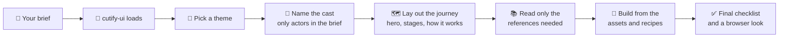

<p align="center"></p>

# 🧸 cutify-ui

**Give Claude a taste for cute. Pixel characters, story stages and motion that explains your product.**

[](https://slyf0xx97.github.io/cutify-ui/)
[](https://github.com/slyf0xx97/cutify-ui/releases/latest)


[](https://github.com/slyf0xx97/cutify-ui/actions)

cutify-ui is an open-source [Claude skill](https://docs.claude.com/en/docs/agents-and-tools/agent-skills/overview) for building playful, game-like web interfaces. Ask Claude for a landing page, a product demo or a dashboard, and the skill gives it a design system, ready components and animation patterns so the result has characters, a story and a personality.

It works in Claude Code, Claude.ai and the Claude API, and it builds in React / Next.js or in plain HTML, CSS and SVG (including pages hosted inside Streamlit).

🌐 Live gallery: https://slyf0xx97.github.io/cutify-ui/

The design language was conceived by [Ghernie Encinas](https://sg.linkedin.com/in/ghernie) across two shipped projects: [itsa10but](https://ghernie.com/projects/itsa10but), a résumé reviewer, and [SkyQueue](https://skyqueue.ghernie.com), a multi-agent airport queue planner built for Autonomous SG 2026. Judges asked how to get the same look, so here it is as a skill.

## 🎯 Problem

Ask an AI model for a "cute" or "playful" page and you usually get the same thing: rounded cards, a pastel gradient, an emoji or two and a bouncing button. Nothing on the page explains the product, the characters (if any) are clip art, and the motion is decoration. For AI products it's worse, because visitors can't tell what the AI does, what the code does and what they decide.

## 💡 Solution

cutify-ui teaches Claude one design grammar and lets the look change around it. Every page gets a cast of pixel-art characters for the actors in the product, a numbered path of stages, tooltips that explain why, sticker-style depth and motion that shows the system at work. Each block says who does it (AI, code or you), and made-up data says it's made up.

The skill ships with two themes taken from the shipped projects, a light frosted-glass look and a dark airfield-signage look, plus the tokens to make your own. Claude reads only the parts a request needs, then builds from real, tested components.

## ✨ Key features

Characters and story

- 👾 String-grid pixel sprites that render as crisp SVG at any size, with pixels that can blink or wave on their own.
- 🗺️ Numbered story stages with an explain strip, so a visitor follows the product step by step.
- 🏷️ AI / Code / You tags and shape cues, so identity and responsibility never rest on colour alone.

Motion that explains

- ✈️ Vehicles that follow the real drawn route with CSS `offset-path`.
- ⏯️ Five animation engines: a cancellable scripted story, a simulation clock, arc hand-offs with the Web Animations API, a scroll-linked journey and a route with stops.
- 🧘 Reduced-motion support and off-screen pausing everywhere.

Components

- 💬 Tooltips that work on hover, focus and tap, including a Popover API version for React.
- 🎮 Game buttons that lift and sink, sticker shadows, pills, meters, KPI tiles, hand-built SVG charts, native `<dialog>` modals, split buttons and loading screens.
- ⚛️ Typed React 19 components (`PixelSprite`, `PixelIcon`, `Popup`, `WordTip`, `StageHeader`, `KindChip`) that pass strict type-checking.
- 🐍 Streamlit helpers: same-origin iframe pages, a hidden-input bridge to Python, small-laptop scaling and an instant loader.

## 🖼️ Gallery

Every example below was built by Claude with this skill from a short brief, then checked in a browser at 1280px and 375px. Click one to open it live.

<!-- GALLERY:START -->
<table>
<tr><td width="50%" valign="top"><a href="https://slyf0xx97.github.io/cutify-ui/examples/studybuddy/"></a><br><b><a href="https://slyf0xx97.github.io/cutify-ui/examples/studybuddy/">StudyBuddy</a></b> (<a href="examples/studybuddy">source</a>)<br>Three AI tutors plan, quiz and check in. You approve the week.<br><sub>🪟 Glass, HTML</sub></td><td width="50%" valign="top"><a href="https://slyf0xx97.github.io/cutify-ui/examples/fleet-queue/"></a><br><b><a href="https://slyf0xx97.github.io/cutify-ui/examples/fleet-queue/">Fleet Queue</a></b> (<a href="examples/fleet-queue">source</a>)<br>Warehouse robots plan the order queue, code blocks unsafe moves, a manager approves.<br><sub>🛫 Apron, HTML</sub></td></tr>
<tr><td width="50%" valign="top"><a href="https://slyf0xx97.github.io/cutify-ui/examples/sprout/"></a><br><b><a href="https://slyf0xx97.github.io/cutify-ui/examples/sprout/">Sprout</a></b> (<a href="examples/sprout">source</a>)<br>Dr. Leaf diagnoses your plant, Drip plans the watering, and the plant perks up.<br><sub>🪟 Glass, HTML</sub></td><td width="50%" valign="top"><a href="https://slyf0xx97.github.io/cutify-ui/examples/gridline/"></a><br><b><a href="https://slyf0xx97.github.io/cutify-ui/examples/gridline/">Gridline</a></b> (<a href="examples/gridline">source</a>)<br>A microgrid control room on a heatwave evening, with power flowing along the wires.<br><sub>🛫 Apron, HTML</sub></td></tr>
<tr><td width="50%" valign="top"><a href="https://slyf0xx97.github.io/cutify-ui/examples/pantry-pals/"></a><br><b><a href="https://slyf0xx97.github.io/cutify-ui/examples/pantry-pals/">Pantry Pals</a></b> (<a href="examples/pantry-pals">source</a>)<br>A Chef and a Shopper plan your week from what's in the fridge.<br><sub>🪟 Glass, Next.js + static copy</sub></td><td width="50%" valign="top"><a href="https://slyf0xx97.github.io/cutify-ui/examples/portfolio/"></a><br><b><a href="https://slyf0xx97.github.io/cutify-ui/examples/portfolio/">Mika Tan, portfolio</a></b> (<a href="examples/portfolio">source</a>)<br>A sample designer portfolio where the avatar walks a trail as you scroll.<br><sub>🪟 Glass, HTML, no AI</sub></td></tr>
</table>
<!-- GALLERY:END -->

## 🧭 How it works



Two themes, one grammar:

| | 🪟 Glass (light) | 🛫 Apron (dark) |
|---|---|---|
| Feel | Frosted glass over painted flat-vector scenery | Airfield signage on a dark dot grid |
| Display type | Pixelify Sans | Anybody, heavy and wide |
| Labels | Atkinson Hyperlegible, bold caps | Spline Sans Mono, tiny letter-spaced caps |
| Accent | Orange buttons, lime highlighter | Taxiway yellow, hi-vis orange |
| From | itsa10but | SkyQueue |

## 🛠️ Install

**Claude Code**

```bash
git clone https://github.com/slyf0xx97/cutify-ui ~/.claude/skills/cutify-ui
```

Then ask for something like "make a cute landing page for my study app with three AI tutors". Claude loads the skill when a request fits.

**Claude.ai**

Download `cutify-ui.zip` from the [latest release](https://github.com/slyf0xx97/cutify-ui/releases/latest) and upload it under Settings → Capabilities → Skills.

**Claude API**

Upload the same zip with the Skills API and attach it to your requests.

### 📁 What's inside

```
SKILL.md                 when to use it, the grammar, the workflow and a final checklist
references/
  themes.md              tokens, fonts and surfaces for each theme, and how to make your own
  pixel-art.md           string-grid sprites, pixel icons, sprite sheets, designing a cast
  motion.md              motion rules, keyframes and five animation engines
  components.md          tooltips, buttons, chips, stage headers, KPI tiles, charts, dialogs, loaders
  react.md               Next.js / React 19 patterns
  streamlit.md           plain HTML pages, and hosting them inside Streamlit
  voice.md               copy and labels
assets/
  glass.css, apron.css   theme tokens and base components
  pixel-sprites.js       turns string grids into crisp SVG symbols, with an example cast
  react/                 typed React 19 components and hooks
  streamlit/             page builder, iframe bridge, scaling and loader helpers
examples/                the gallery, each a working page
evals/                   test prompts used to check the skill
```

## 🧪 Testing

The skill was checked the way Anthropic's skill-creator recommends: the same three prompts were run with and without the skill, and each page was graded on objective checks (crisp pixel art, reduced motion, AI/You tags, numbered stages, keyboard tooltips, hard shadows, plus case-specific ones).

| Test prompt | With cutify-ui | Without |
|---|---|---|
| StudyBuddy landing page (HTML) | 6 / 6 | 2 / 6 |
| Warehouse robot demo, dark (HTML) | 9 / 9 | 3 / 9 |
| Pantry Pals meal planner (Next.js) | 6 / 7 | 3 / 7 |

That's a 95% pass rate with the skill and 36% without, on 3 prompts with one run each. Treat it as a direction, not a benchmark. The prompts are in [`evals/`](evals).

## 🛡️ Safety and limitations

✅ What the skill does and doesn't do:

- It's instructions, CSS, and small JS and TypeScript files. It makes no network calls and holds no keys.
- The examples load fonts from Google Fonts. Everything else is inline.
- All characters, icons and example data are original. Third-party logos are deliberately left out, and the skill tells Claude not to copy them in.
- Example data is made up and labelled as sample data on every page.

⚠️ Limitations:

- Claude still decides the final design, so results vary by prompt and model.
- Pages with heavy animation took Claude about 5 to 10 minutes to build and check, much longer than a plain page.
- Examples were checked in Chromium at 1280px and 375px. Safari, Firefox and screen readers weren't tested.
- Some charts in the examples are sized when the page loads, so resizing the window afterwards can leave them too wide until you reload.

## 🤝 Contributing

New themes, components and examples are welcome. See [CONTRIBUTING.md](CONTRIBUTING.md). To report a security problem, see [SECURITY.md](SECURITY.md).

## 📄 License

MIT, copyright 2026 Ghernie Encinas. See [LICENSE](LICENSE). Fonts are loaded from Google Fonts under the SIL Open Font License: Pixelify Sans, Atkinson Hyperlegible, Anybody and Spline Sans Mono.
