<p align="center">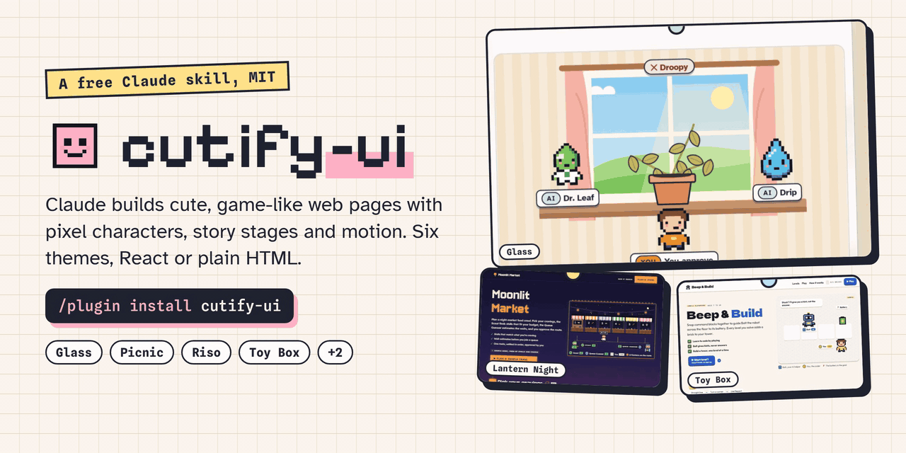</p>

#  cutify-ui

**A Claude Code skill for cute, pixel-art, game-like UI. Claude builds landing pages, prototypes and animated process flows with pixel characters, story stages and motion that shows your product at work.**

[](https://github.com/slyf0xx97/cutify-ui/stargazers)
[](https://github.com/slyf0xx97/cutify-ui/forks)
[](https://github.com/slyf0xx97/cutify-ui/watchers)
[](LICENSE)


[](https://docs.claude.com/en/docs/agents-and-tools/agent-skills/overview)


[](https://github.com/slyf0xx97/cutify-ui/actions)
[](https://scorecard.dev/viewer/?uri=github.com/slyf0xx97/cutify-ui)

cutify-ui is an open-source [Claude skill](https://docs.claude.com/en/docs/agents-and-tools/agent-skills/overview). Ask Claude for a landing page, a product demo or a portfolio, and the skill gives it themes, ready components and animation patterns to build from. It works in Claude Code, Claude.ai and the Claude API, and builds in React and Next.js or in plain HTML, CSS and SVG.

<p align="center"><a href="https://cutify.ghernie.com/">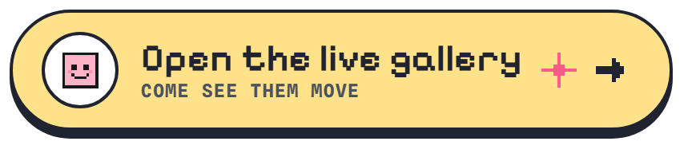</a></p>

<p align="center"><a href="https://buy.stripe.com/00w4gr2TU7wC52iaXf18c01">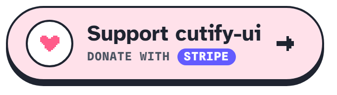</a>&nbsp;&nbsp;<a href="https://ko-fi.com/K6P629UOFQ">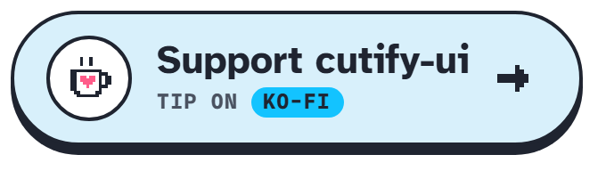</a></p>

## Contents

<table>
<tr><th align="left" width="25%">🚀 Start<br></th><th align="left" width="25%">👀 Look<br></th><th align="left" width="25%">🔧 Build<br></th><th align="left" width="25%">📄 About<br></th></tr>
<tr><td valign="top"><a href="#%EF%B8%8F-install">Install</a><br><a href="#quickstart">Quickstart</a></td><td valign="top"><a href="#%EF%B8%8F-gallery">Gallery</a><br><a href="#-features">Features</a></td><td valign="top"><a href="#-whats-inside">What's inside</a><br><a href="#-testing-and-validation">Testing and validation</a></td><td valign="top"><a href="#%EF%B8%8F-privacy-and-limits">Privacy and limits</a><br><a href="#-faq">FAQ</a><br><a href="#-contributing">Contributing</a><br><a href="#-support">Support</a><br><a href="#-license">License</a></td></tr>
</table>

## 🛠️ Install

In Claude Code, paste this one line into the chat:

```
/plugin install cutify-ui --marketplace slyf0xx97/cutify-ui
```

For Cursor, Codex, Gemini CLI or another coding agent, run this one line in your terminal and pick your agent:

```bash
npx skills add slyf0xx97/cutify-ui
```

That's all. Ask for a cute landing page and your agent uses the skill on its own.

<details>
<summary>Claude.ai, the Claude API and older versions of Claude Code</summary>

- Claude.ai: download `cutify-ui.zip` from the [latest release](https://github.com/slyf0xx97/cutify-ui/releases/latest) and upload it under Settings → Capabilities → Skills.
- Claude API: upload the same zip with the Skills API and attach it to your requests.
- Claude Code older than 2.1.275: run `/plugin marketplace add slyf0xx97/cutify-ui`, then `/plugin install cutify-ui@cutify-ui`.

</details>

### Quickstart

> [!TIP]
> **See all the example pages live at [cutify.ghernie.com](https://cutify.ghernie.com/)**, each with the prompt that made it, ready to copy.

Ask in plain words, for example:

```text
Make a cute landing page for my study app with three AI tutors.
```

| What you're building | Model | Effort |
|---|---|---|
| A full page with several sections | Opus 5.5 | High |
| One component, such as a pricing card | Sonnet 5.5 | Default |
| A quick draft to try ideas | Sonnet 5.5 or Haiku 5.5 | Low |

Set the effort with `/effort` in Claude Code. Our test pages used the default effort, and Opus took about 5 to 7 minutes a page. High effort gives Claude more room to plan the stages and check its own page, so it's worth the extra time on bigger pages.

Have Python 3 installed so Claude can check its page with `scripts/lint_page.py`. If the skill doesn't load, start your prompt with "Use the cutify-ui skill." Every example in the [Gallery](#%EF%B8%8F-gallery) has its prompt ready to copy.

## ✨ Features

<p align="center"></p>

Six themes come ready to use: Glass, Apron, Picnic, Riso Club, Lantern Night and Toy Box. Claude can also make a new theme from your brief, as Snooze Log and Penpal Post in the gallery show. Glass and Apron come from [itsa10but](https://ghernie.com/projects/itsa10but) and [SkyQueue](https://skyqueue.ghernie.com), and the [inspiration library](docs/INSPIRATION.md) credits the sources behind the rest.

## 🖼️ Gallery

Claude built each example with the skill from a brief of a few sentences, then checked it in a browser at widths from 375px to 1440px. The first six briefs described only the product and its characters, and the next six also named a theme or palette. The newest six cover other kinds of page: a phone prototype, a CI pipeline explainer, an approval workflow, a delivery map, an event site and a staff training flow. None of the six has AI in the product, and three use themes Claude made up from the brief. Click a picture to open the page, and copy any brief from the list under the gallery.

<!-- GALLERY:START -->
<table>
<tr>
<td width="33%" valign="top"><a href="https://cutify.ghernie.com/examples/studybuddy/">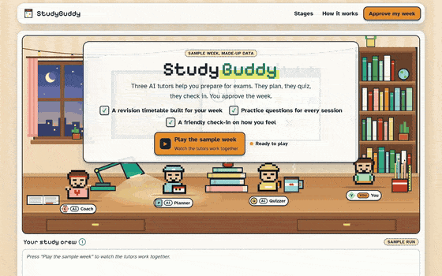</a><br><b><a href="https://cutify.ghernie.com/examples/studybuddy/">StudyBuddy</a></b> <sub>(<a href="examples/studybuddy">source</a>)</sub><br><sub>🪟 Glass, HTML</sub></td>
<td width="33%" valign="top"><a href="https://cutify.ghernie.com/examples/fleet-queue/">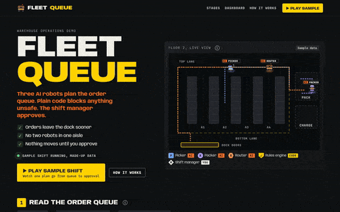</a><br><b><a href="https://cutify.ghernie.com/examples/fleet-queue/">Fleet Queue</a></b> <sub>(<a href="examples/fleet-queue">source</a>)</sub><br><sub>🛫 Apron, HTML</sub></td>
<td width="33%" valign="top"><a href="https://cutify.ghernie.com/examples/sunday-spread/">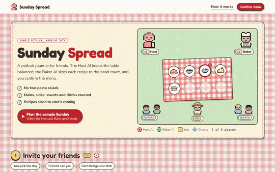</a><br><b><a href="https://cutify.ghernie.com/examples/sunday-spread/">Sunday Spread</a></b> <sub>(<a href="examples/sunday-spread">source</a>)</sub><br><sub>🧺 Picnic, HTML</sub></td>
</tr>
<tr>
<td width="33%" valign="top"><a href="https://cutify.ghernie.com/examples/zine-night/">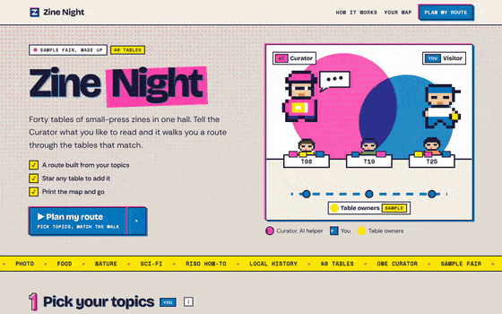</a><br><b><a href="https://cutify.ghernie.com/examples/zine-night/">Zine Night</a></b> <sub>(<a href="examples/zine-night">source</a>)</sub><br><sub>🖨️ Riso Club, HTML</sub></td>
<td width="33%" valign="top"><a href="https://cutify.ghernie.com/examples/moonlit-market/">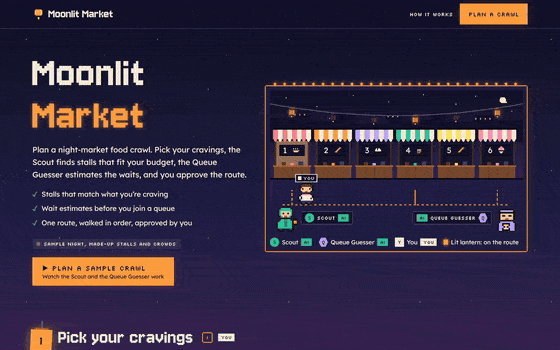</a><br><b><a href="https://cutify.ghernie.com/examples/moonlit-market/">Moonlit Market</a></b> <sub>(<a href="examples/moonlit-market">source</a>)</sub><br><sub>🏮 Lantern Night, HTML</sub></td>
<td width="33%" valign="top"><a href="https://cutify.ghernie.com/examples/beep-and-build/">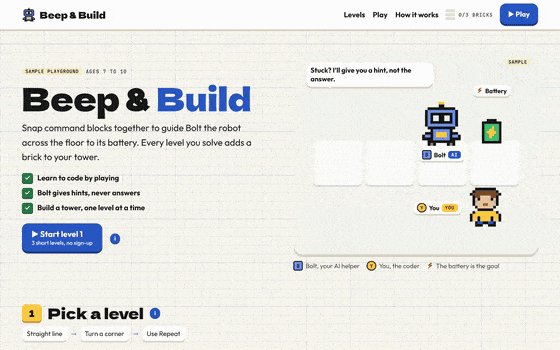</a><br><b><a href="https://cutify.ghernie.com/examples/beep-and-build/">Beep &amp; Build</a></b> <sub>(<a href="examples/beep-and-build">source</a>)</sub><br><sub>🧱 Toy Box, HTML, playable</sub></td>
</tr>
<tr>
<td width="33%" valign="top"><a href="https://cutify.ghernie.com/examples/sprout/">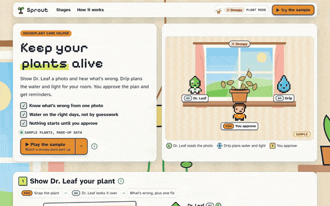</a><br><b><a href="https://cutify.ghernie.com/examples/sprout/">Sprout</a></b> <sub>(<a href="examples/sprout">source</a>)</sub><br><sub>🪟 Glass, HTML</sub></td>
<td width="33%" valign="top"><a href="https://cutify.ghernie.com/examples/gridline/">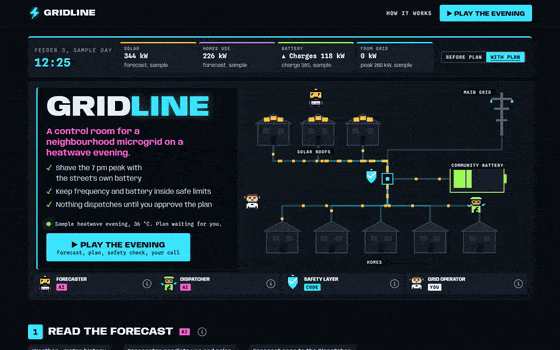</a><br><b><a href="https://cutify.ghernie.com/examples/gridline/">Gridline</a></b> <sub>(<a href="examples/gridline">source</a>)</sub><br><sub>🛫 Apron, electric palette, HTML</sub></td>
<td width="33%" valign="top"><a href="https://cutify.ghernie.com/examples/snooze-log/">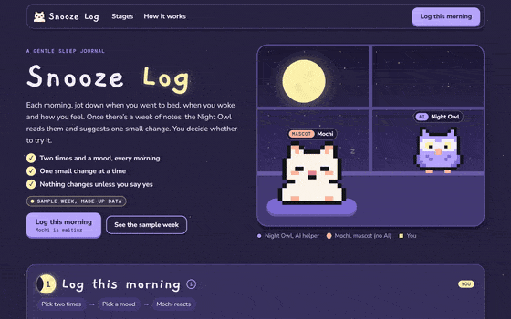</a><br><b><a href="https://cutify.ghernie.com/examples/snooze-log/">Snooze Log</a></b> <sub>(<a href="examples/snooze-log">source</a>)</sub><br><sub>🌙 Custom: Sleepy Dusk, HTML</sub></td>
</tr>
<tr>
<td width="33%" valign="top"><a href="https://cutify.ghernie.com/examples/penpal-post/">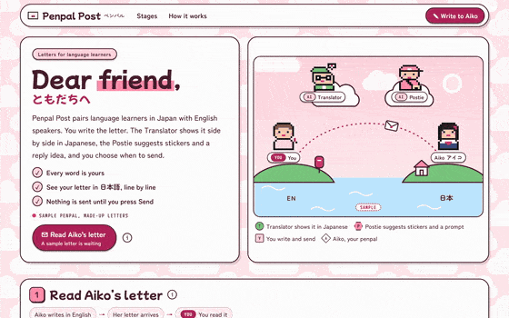</a><br><b><a href="https://cutify.ghernie.com/examples/penpal-post/">Penpal Post</a></b> <sub>(<a href="examples/penpal-post">source</a>)</sub><br><sub>🍓 Custom: Strawberry Milk + Kawaii JP, HTML</sub></td>
<td width="33%" valign="top"><a href="https://cutify.ghernie.com/examples/pantry-pals/">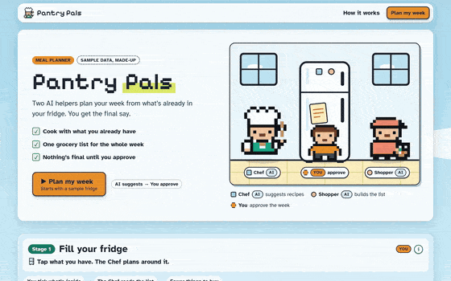</a><br><b><a href="https://cutify.ghernie.com/examples/pantry-pals/">Pantry Pals</a></b> <sub>(<a href="examples/pantry-pals">source</a>)</sub><br><sub>🪟 Glass, Next.js + static copy</sub></td>
<td width="33%" valign="top"><a href="https://cutify.ghernie.com/examples/portfolio/">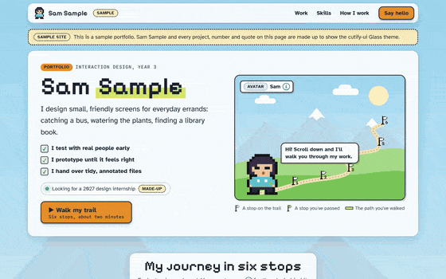</a><br><b><a href="https://cutify.ghernie.com/examples/portfolio/">Sam Sample, portfolio</a></b> <sub>(<a href="examples/portfolio">source</a>)</sub><br><sub>🪟 Glass, HTML, no AI</sub></td>
</tr>
<tr>
<td width="33%" valign="top"><a href="https://cutify.ghernie.com/examples/pocket-money/">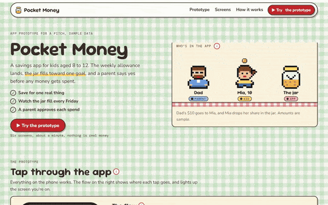</a><br><b><a href="https://cutify.ghernie.com/examples/pocket-money/">Pocket Money</a></b> <sub>(<a href="examples/pocket-money">source</a>)</sub><br><sub>🧺 Picnic, HTML, phone prototype</sub></td>
<td width="33%" valign="top"><a href="https://cutify.ghernie.com/examples/ship-it/">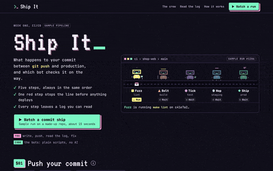</a><br><b><a href="https://cutify.ghernie.com/examples/ship-it/">Ship It</a></b> <sub>(<a href="examples/ship-it">source</a>)</sub><br><sub>💻 Custom: Terminal Candy, HTML, no AI</sub></td>
<td width="33%" valign="top"><a href="https://cutify.ghernie.com/examples/tally/">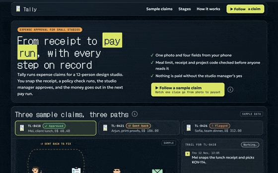</a><br><b><a href="https://cutify.ghernie.com/examples/tally/">Tally</a></b> <sub>(<a href="examples/tally">source</a>)</sub><br><sub>🪟 Glass dark, HTML, process flow</sub></td>
</tr>
<tr>
<td width="33%" valign="top"><a href="https://cutify.ghernie.com/examples/parcel-pigeon/">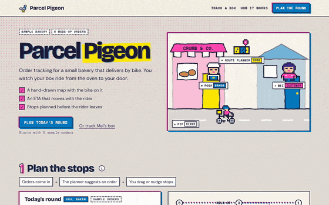</a><br><b><a href="https://cutify.ghernie.com/examples/parcel-pigeon/">Parcel Pigeon</a></b> <sub>(<a href="examples/parcel-pigeon">source</a>)</sub><br><sub>🖨️ Riso Club, HTML, no AI</sub></td>
<td width="33%" valign="top"><a href="https://cutify.ghernie.com/examples/pixel-fest/">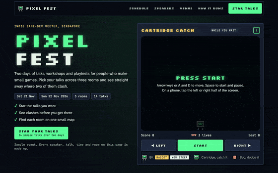</a><br><b><a href="https://cutify.ghernie.com/examples/pixel-fest/">Pixel Fest</a></b> <sub>(<a href="examples/pixel-fest">source</a>)</sub><br><sub>🕹️ Custom: Arcade Night, HTML, playable, no AI</sub></td>
<td width="33%" valign="top"><a href="https://cutify.ghernie.com/examples/ramen-route/">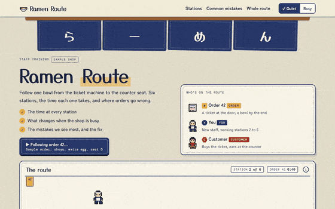</a><br><b><a href="https://cutify.ghernie.com/examples/ramen-route/">Ramen Route</a></b> <sub>(<a href="examples/ramen-route">source</a>)</sub><br><sub>🍜 Custom: Noren, HTML, no AI</sub></td>
</tr>
</table>

<details><summary><b>Copy an example's prompt</b></summary>

**StudyBuddy**

```text
StudyBuddy, an exam-prep app for university students. Three AI tutors: a Planner that builds a revision timetable, a Quizzer that writes practice questions, and a Coach that checks in on your mood. The student approves their weekly plan. Use the Glass (light) theme. A cute, friendly, game-like single-page landing site with animation that shows the tutors working together.
```

**Fleet Queue**

```text
Fleet Queue, a warehouse operations demo. Three AI agents (Picker, Packer and Router robots) coordinate the order queue, a rules engine (plain code) blocks unsafe plans (aisle congestion, battery level, weight limits), and the shift manager approves the final plan. Apron (dark control-room) theme. Robots visibly move along drawn aisles, with a small before/after dashboard. All numbers are labelled sample data.
```

**Sunday Spread**

```text
"Sunday Spread", a potluck planner for friends. Two AI helpers: the Host, who suggests dishes so nothing doubles up and the meal is balanced, and the Baker, who scales recipes to the guest count. Guests claim dishes; you (the organiser) confirm the menu in a native <dialog>, with a confetti micro-interaction (and a reduced-motion fallback). Picnic theme (assets/picnic.css): gingham backdrop, Fredoka + Nunito + DM Mono, jam-jar-lid stage numbers, paper-tag tooltips. Only this cast (Host AI, Baker AI, You, plus guest avatars as simple pixel sprites); invent no other mechanics. Data is made up and labelled as sample.
```

**Zine Night**

```text
"Zine Night", the page for a (made-up) indie zine fair with 40 tables. One AI helper, the Curator, builds a walking route through the tables from the topics you like; you star tables and approve your route, then get a printable map. Riso Club theme (assets/riso.css): newsprint + grain backdrop with a pink halftone fade behind the hero, Bricolage Grotesque + Rethink Sans + Space Mono, misregistered pink/blue double shadows, outlined stage numbers, a marquee strip divider, overprint (multiply) effects. Draw the fair floor as an SVG map and animate the route drawing itself (self-drawing line) and a pixel visitor walking it. Only this cast (Curator AI, You, simple pixel table-owner sprites); invent nothing else. All data made up and labelled sample.
```

**Moonlit Market**

```text
"Moonlit Market", a night-market food crawl planner. Two AI helpers: the Scout, who finds stalls that match your cravings and budget, and the Queue Guesser, who estimates waits from (sample) crowd data. You pick your cravings and approve the crawl route. Lantern Night theme (assets/lantern.css): dusk sky with stars and a dithered skyline, Jersey 10 headings + Silkscreen tags + Lexend body + Sometype Mono, stepped pixel borders, lantern glows, swaying lanterns over stage numbers with the active one lit, typing dots while an agent thinks. Draw a pixel market street of stalls (original art, no real brands) and animate a pixel visitor walking the chosen route with steps() easing. Only this cast; invent nothing else. All data made up and labelled sample.
```

**Beep & Build**

```text
"Beep & Build", a coding playground for kids aged 7 to 10. A small robot mascot, Bolt (an AI helper that gives hints, never answers), and the child (You). The child snaps command blocks (forward, turn left, turn right, repeat) to guide Bolt across a grid to a battery; Bolt gives a hint after two failed tries. Each solved level adds a brick to a progress tower. Toy Box theme (assets/toybox.css): graph paper backdrop with an isometric floor under the play grid, Dela Gothic One + Outfit + JetBrains Mono, white plastic cards, ledge buttons that press down, brick chips with studs (keep bricks generic; no brand names or references to any toy company). The play area must actually work for 3 short levels. Animate Bolt moving step by step along the program. Only this cast; invent nothing else. Mark it as a sample.
```

**Sprout**

```text
Sprout, a plant-care companion for people who keep killing houseplants. Two AI helpers: Dr. Leaf looks at a photo of a plant and says what's wrong, and Drip plans a watering and light schedule from the plant type and your room. You approve the care plan and get reminders. Glass (light) theme, cosy and cute, with a painted indoor window-sill scene. Animation shows the plant perking up as care happens.
```

**Gridline**

```text
Gridline, a control room for a neighbourhood microgrid during a heatwave. Two AI agents: a Forecaster that predicts demand and solar output, and a Dispatcher that decides when the community battery charges and discharges. A safety layer in plain code keeps grid frequency and battery limits. The grid operator approves the evening plan. Animate power flowing along the drawn lines between solar roofs, the battery and houses; show before/after peak load. All numbers labelled sample data.
```

**Snooze Log**

```text
Snooze Log, a gentle sleep journal. A sleepy pixel cat, Mochi, is the mascot (no AI). One AI helper, the Night Owl, reads your week of (sample) sleep notes and suggests one small change. You log bedtime and mood each morning and decide whether to try the suggestion. This is a NEW theme you make by swapping tokens: the Sleepy Dusk palette from themes.md (dusk #2B2545, cloud #3A3260, lavender #B8A6FF, peach #FFB8A0, star #FFF3B0, ink #F4F0FF), the "dusk with stars" backdrop, the Notebook font pairing (Gaegu 700 for headings at ≥22px, Nunito Sans body, DM Mono), soft rounded cards, and the "idle pet blink" micro-interaction for Mochi (who sleeps more when your sleep is short). A week chart of hours slept (sample), stage numbers as little moons. Only this cast; invent nothing else. All data made up and labelled sample.
```

**Penpal Post**

```text
Penpal Post, a letter-writing app that pairs language learners in Japan and English-speaking countries. Two AI helpers: the Translator, who shows a gentle side-by-side translation of your letter, and the Postie, who suggests stickers and a reply prompt. You write the letter and choose when to send. This is a NEW theme you make by swapping tokens: the Strawberry Milk palette from themes.md, the cloud wallpaper backdrop, the Kawaii JP font pairing (Mochiy Pop One display at ≥20px, Zen Maru Gothic body, M PLUS 1 Code mono), pill buttons, speech-bubble tooltips with one sharp corner (radius 24px 24px 24px 4px), the sticker-wobble micro-interaction on stickers, and a letter that folds into an envelope and flies off when sent (with reduced-motion fallback). Show some Japanese text (kana/kanji) correctly. Only this cast (Translator AI, Postie AI, You, and your penpal Aiko shown as a pixel avatar); invent nothing else. All data and letters made up and labelled sample.
```

**Pantry Pals**

```text
Pantry Pals, a meal planner. Two AI helpers: a Chef that suggests recipes from what's in your fridge and a Shopper that builds the grocery list. You approve the weekly plan (use the skill's native <dialog> Popup). Glass (light) theme, playful and cute.
```

**Sam Sample, portfolio**

```text
A personal portfolio site for "Sam Sample" (a made-up interaction design student). No AI in this product: the cast is Sam's pixel-art avatar as a mascot, and the numbered stages are Sam's journey (About, three case studies, Skills, Contact). The avatar walks a trail as you scroll. Glass (light) theme. Each case study card opens a native <dialog> with details. Clearly mark it as a sample portfolio with made-up projects.
```

**Pocket Money**

```text
Pocket Money, a mobile app prototype that helps kids aged 8 to 12 save their allowance. Show it as a clickable phone prototype on the page: onboarding, setting a savings goal (a new bike), a weekly allowance coming in, and a jar that fills up. A parent approves spending requests. Picnic theme. Make it feel like a real app prototype a designer would show in a pitch, with the screens linked by a little flow diagram.
```

**Ship It**

```text
Ship It, an explainer page for our team's CI/CD pipeline, for new engineers in their first week. Show a commit travelling through lint, build, unit tests, a staging deploy and a production deploy, with a small pixel crew of bots running each step. Include one run where a failing test stops the deploy, and show how to read the logs. No AI agents, it's all plain automation. Make up a custom theme called Terminal Candy: dark, monospace, pastel neon.
```

**Tally**

```text
Tally, an expense approval tool for a 12-person design studio. Map the process flow from snapping a receipt, to an automatic policy check (meal limit, missing receipt, wrong project code), to the studio manager's approval, to the payout in the next pay run. Show three sample claims taking different paths, one approved, one sent back, one flagged. Glass theme in dark mode. It should look like a polished B2B product page that a finance lead would trust.
```

**Parcel Pigeon**

```text
Parcel Pigeon, order tracking for a small neighbourhood bakery that delivers by bike. The customer sees a hand-drawn map of the neighbourhood with the courier pedalling along the route, a status timeline (baked, boxed, out for delivery, at your door) and an ETA that updates. A route planner suggests the stop order and the baker can drag stops to reorder before the rider leaves. Riso Club theme.
```

**Pixel Fest**

```text
Pixel Fest, the website for a two-day indie game-dev meetup in Singapore. A schedule across three rooms where you can star talks and see clashes, speaker cards, a small venue map, and a playable mini-game in the hero while people wait. No AI in the product. Make up a custom theme called Arcade Night: a CRT screen glow, scanlines and chunky 8-bit type, but still easy to read.
```

**Ramen Route**

```text
Ramen Route, an animated process flow for training new staff at a small ramen shop. Follow one order from the ticket machine, to the noodle station, broth, toppings and the pass, to the customer's counter seat. Show the timing at each station, what happens when the shop is busy, and where orders usually go wrong. Make up a custom theme called Noren: indigo and cream like a shop curtain, warm and hand-made. No AI, it's a training page.
```

</details>
<!-- GALLERY:END -->

## 📁 What's inside

```
plugin/                    the Claude Code plugin, the only part an install downloads
  .claude-plugin/          plugin.json and the plugin icon
  README.md                what the plugin contains, runs and sends
  skills/cutify-ui/
    SKILL.md               when to use the skill, the design rules, the workflow and a final checklist
    references/
      themes.md            the six themes, their palettes, and how to make your own
      backgrounds.md       19 backdrops and how to choose one
      fonts.md             font pairings and readability rules
      pixel-art.md         sprites, pixel icons and designing characters
      motion.md            motion rules, animation patterns and small interactions
      components.md        tooltips, buttons, stage headers, number tiles, charts, dialogs and loaders
      react.md             React 19 and Next.js patterns
      streamlit.md         plain HTML pages and hosting them in Streamlit
      voice.md             how labels and copy should read
    scripts/
      lint_page.py         checks a finished page for the problems the skill rules out
    assets/
      starter.html         a page skeleton that works with every theme, so Claude edits instead of starting blank
      <theme>.css          one stylesheet per theme, all with the same class names
      pixel-sprites.js     turns text grids into crisp SVG sprites
      react/               typed React 19 components and their stylesheet
      streamlit/           helpers for hosting pages in Streamlit
    evals/                 test prompts and graders for the skill
.claude-plugin/            marketplace.json, which points Claude Code at plugin/
examples/                  the gallery pages, each with its brief
docs/INSPIRATION.md        the sources behind the themes
tools/                     repo checks, layout QA and gallery screenshot scripts
```

## 🧪 Testing and validation

### Automatic checks

Every push runs these checks on GitHub Actions, and you can run them yourself with `cd tools && npm install && npm run check`.

| Area | What's checked | How |
|---|---|---|
| Skill file | `SKILL.md` has the right name, a description under 1,024 characters, fewer than 500 lines, and every file it mentions exists | [`check.mjs`](tools/check.mjs) |
| Themes | All six theme stylesheets define the same 14 variables and 11 classes, so a component works in any theme | [`check.mjs`](tools/check.mjs) |
| CSS | Every stylesheet and every `<style>` block in the gallery and examples is valid CSS | [csstree-validator](https://github.com/csstree/validator) |
| Smooth motion | No animation loop changes `box-shadow`, `filter`, `background-position` or layout properties, which make the browser repaint every frame | [`check.mjs`](tools/check.mjs) |
| Page linter | [`lint_page.py`](plugin/skills/cutify-ui/scripts/lint_page.py), the script the skill has Claude run on each page it builds, passes on every example and the gallery | Python, no packages |
| Linter self-test | Eight small broken pages each trip their check (a skewed sprite row, a script syntax error, bare `fr` columns, widths too wide for a phone), and the safe cases pass | [`lint-test.py`](tools/lint-test.py) |
| React types | The React 19 components pass TypeScript in strict mode | `tsc --strict` |
| React rendering | Each component renders, and its markup is accessible: sprites have `role="img"` and a label, tooltip triggers are labelled buttons that point at a tip that exists, and modals use a native `<dialog>` | [`react-test.mjs`](tools/react-test.mjs) |
| JavaScript and Python | Every `.js`, `.mjs` and `.py` file parses | `node --check`, `py_compile` |
| Examples | Each example has its page, README and screenshot, stops moving for reduced motion, labels made-up data as "sample", and loads nothing from outside except fonts | [`check.mjs`](tools/check.mjs) |
| Page weight | Each example page is under 150 KB before fonts | [`check.mjs`](tools/check.mjs) |
| Plugin | The Claude Code plugin and marketplace files pass strict validation, their names match, and the version matches the changelog | `claude plugin validate --strict` |

<details>
<summary>Output of the last <code>npm run check</code></summary>

```
SKILL.md
  ✓ name is cutify-ui
  ✓ description is 930 characters
  ✓ 159 lines (under 500)
  ✓ every path SKILL.md mentions exists
  ✓ all six themes define the shared contract variables and classes
TypeScript (strict)
  ✓ assets/react type-checks
React render test
  ✓ PixelSprite renders
  ✓ PixelSprite (decorative) renders
  ✓ PixelIcon renders
  ✓ KindChip renders
  ✓ StageHeader renders
  ✓ WordTip renders
  ✓ Popup renders
JavaScript and Python syntax
  ✓ all .js files parse
  ✓ 5 Python files compile
Examples
  ✓ beep-and-build has its page, README and screenshot
  ✓ fleet-queue has its page, README and screenshot
  ✓ gridline has its page, README and screenshot
  ✓ moonlit-market has its page, README and screenshot
  ✓ pantry-pals has its page, README and screenshot
  ✓ penpal-post has its page, README and screenshot
  ✓ portfolio has its page, README and screenshot
  ✓ snooze-log has its page, README and screenshot
  ✓ sprout has its page, README and screenshot
  ✓ studybuddy has its page, README and screenshot
  ✓ sunday-spread has its page, README and screenshot
  ✓ zine-night has its page, README and screenshot
CSS
  ✓ 21 stylesheets and <style> blocks are valid CSS
Smooth motion
  ✓ every @keyframes animates only transform, opacity or other cheap properties
Page linter
  ✓ scripts/lint_page.py passes on 13 pages
Page weight
  ✓ every example page is under 150 KB before fonts
Plugin manifest
  ✓ plugin and marketplace names match
  ✓ plugin version 0.3.0 matches the changelog
  ✓ plugin icon exists
Copy
  ✓ no middle-dot separators in the main copy
All checks passed.
```

</details>

### Layout checks

[`qa.mjs`](tools/qa.mjs) opens every example in Chromium at 375px, 768px, 1280px and 1440px. It reports sideways scrolling, overlapping or clipped text, tooltips that leave the screen or get covered, dialogs that don't fit, console errors, fonts that didn't load and low contrast. [CONTRIBUTING.md](CONTRIBUTING.md#layout-qa) explains how to read its report.

### Accessibility

[`a11y.mjs`](tools/a11y.mjs) runs [axe-core](https://github.com/dequelabs/axe-core) against WCAG 2.1 A and AA rules on every example and the gallery, at 390px and 1280px. All 19 pages pass with no serious or critical findings. It's an automated check, so it doesn't replace trying the pages with a real screen reader.

### Prompt tests

The skill is tested the way Anthropic's skill-creator suggests. The same prompts run with and without the skill, and each page is graded on 10 to 17 checks:

- the skill's own rules, such as crisp pixel art, reduced motion, AI and You tags, numbered stages and keyboard tooltips
- the usual signs of an AI-made page, such as purple gradients, emoji icons and Inter headings
- the page linter
- a real browser load at 390px and 1280px with no script errors and no sideways scroll
- strict TypeScript for the Next.js case

| Test prompt | v0.5 skill | v0.4 skill | No skill |
|---|---|---|---|
| Bakery pre-order page, theme left to Claude | 17 / 17 | 17 / 17 | 11 / 17 |
| StudyBuddy landing page | 13 / 13 | 12 / 13, scrolled sideways on a phone | 7 / 13 |
| Warehouse robot demo, dark | 16 / 16 | 15 / 16, rules had no IDs | 10 / 16 |
| Pantry Pals meal planner, Next.js | 12 / 12 | 12 / 12 | 8 / 14 |
| Just a Toy Box pricing card | 10 / 10 | 10 / 10 | 9 / 10 |
| Clickable app prototype | 11 / 11 | 11 / 11 | not run |
| Library reservation flow with rules | 12 / 12 | 11 / 12, rules had no IDs | not run |

A second test checks when the skill switches on. 20 prompts ran twice each: 10 that should use the skill and 10 near-misses that shouldn't, such as a corporate dashboard, a Godot sprite sheet and a cute birthday message. The v0.4 description caught 19 of 20 and missed a game-jam site. The v0.5 description caught 20 of 20 and still left all 10 near-misses alone.

Each prompt ran once per version, so read these as a direction, not a benchmark. The starter page in v0.5 didn't make builds faster: tokens fell about 3% and time didn't improve. The prompts and graders are in [`evals/`](plugin/skills/cutify-ui/evals).

## 🛡️ Privacy and limits

What the skill does

- It's instructions plus CSS and small JavaScript, TypeScript and Python files. It holds no keys and sends no data anywhere.
- The theme stylesheets load fonts from Google Fonts, so every visitor's browser asks Google for the font files and shares its IP address with Google. If that matters for your users, for example under the GDPR, host the fonts yourself as `references/themes.md` describes.
- The characters, icons, scenes and example data were drawn or written for this project. The skill leaves out third-party logos and tells Claude not to add them.

What to expect

- Claude still makes the final design decisions, so results vary with the prompt and the model.
- A page with a lot of animation took Claude about 5 to 10 minutes to build and check.
- The examples were checked in Chromium, Firefox and WebKit (the engine inside Safari) at phone and desktop widths, with no page errors and no sideways scrolling. They haven't been tried in Safari on an Apple device or with a screen reader yet.

## ❓ FAQ

<details>
<summary><b>How do I install a Claude skill in Claude Code?</b></summary>

Paste `/plugin install cutify-ui --marketplace slyf0xx97/cutify-ui` into the Claude Code chat. Claude Code adds the cutify-ui marketplace and installs the skill in one step. The [Install](#%EF%B8%8F-install) section covers Claude.ai, the Claude API and other coding agents.

</details>

<details>
<summary><b>Does cutify-ui work with Cursor, Codex or Gemini CLI?</b></summary>

Yes. Run `npx skills add slyf0xx97/cutify-ui` in your terminal and pick your agent. The skill is plain Markdown, CSS and small scripts, so any agent that reads skills can use it.

</details>

<details>
<summary><b>Can it build React or Next.js components, or only HTML?</b></summary>

Both. It ships typed React 19 components that work in Next.js, plain HTML, CSS and SVG versions of the same pieces, and a Streamlit helper. Tell Claude which stack you want in your prompt.

</details>

<details>
<summary><b>How do I stop Claude's UI from looking AI-generated?</b></summary>

The skill lists the usual signs of an AI-made page, such as purple gradients, emoji icons and a centred hero over three feature boxes, and tells Claude to avoid them. It also gives Claude a cast of characters, numbered stages and a theme to build from, so each page has its own look. The [Features](#-features) card lists them.

</details>

<details>
<summary><b>Is cutify-ui free?</b></summary>

Yes. It's open source under the MIT licence, so you can use it in personal and commercial projects.

</details>

## 🤝 Contributing

New themes, components and examples are welcome. [CONTRIBUTING.md](CONTRIBUTING.md) explains how to add each one and how to run the checks.

- Issues labelled [good first issue](https://github.com/slyf0xx97/cutify-ui/labels/good%20first%20issue) are small and well described, such as trying the examples with a screen reader.
- Ask questions or share a page you built in [Discussions](https://github.com/slyf0xx97/cutify-ui/discussions).
- Everyone taking part follows the [code of conduct](CODE_OF_CONDUCT.md).
- Report security problems privately, as [SECURITY.md](SECURITY.md) describes.

## 💖 Support

<p><a href="https://buy.stripe.com/00w4gr2TU7wC52iaXf18c01"></a>&nbsp;&nbsp;<a href="https://ko-fi.com/K6P629UOFQ"></a></p>

If cutify-ui saves you time, you can leave a tip through [Stripe](https://buy.stripe.com/00w4gr2TU7wC52iaXf18c01) or [Ko-fi](https://ko-fi.com/K6P629UOFQ). You choose the amount on either site. Tips are voluntary and don't unlock anything, because the skill stays free for everyone. If you tipped by mistake, email ghernienienie@gmail.com within 30 days for a refund.

### ⭐ Star history

[](https://star-history.com/#slyf0xx97/cutify-ui&Date)

## 📄 License

MIT, copyright 2026 [Ghernie Encinas](https://www.linkedin.com/in/ghernie). See [LICENSE](LICENSE).

Every font the skill uses comes from Google Fonts under the SIL Open Font License 1.1, and [`references/fonts.md`](plugin/skills/cutify-ui/references/fonts.md) lists them with links. If you host the fonts yourself, keep each font's `OFL.txt` file with them.

cutify-ui is an independent project and isn't affiliated with or endorsed by Anthropic. Claude is a trademark of Anthropic. The product and character names in the examples (StudyBuddy, Fleet Queue, Sprout, Gridline, Pantry Pals, Sunday Spread, Zine Night, Moonlit Market, Beep & Build, Snooze Log, Penpal Post, Sam Sample, Pocket Money, Ship It, Tally, Parcel Pigeon, Pixel Fest and Ramen Route) are made up and don't refer to real products or people.
