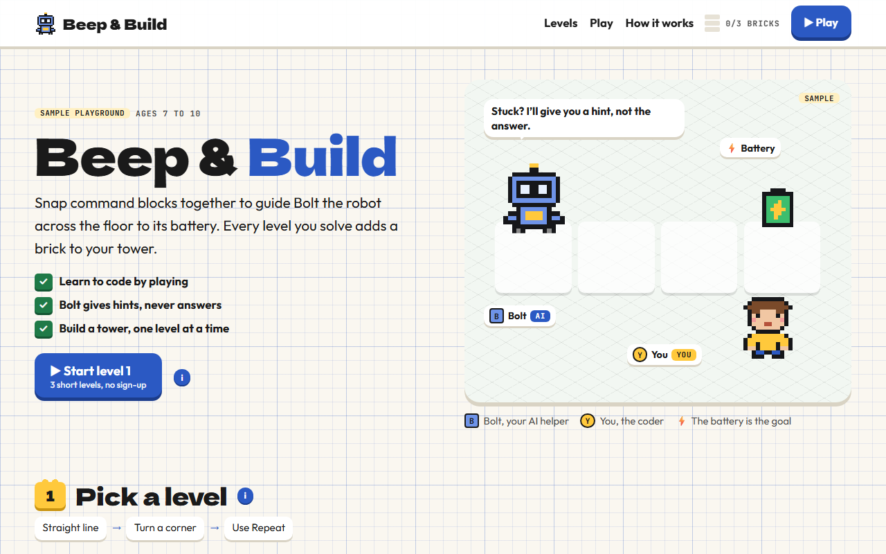

# Beep & Build

**[Open it live](https://cutify.ghernie.com/examples/beep-and-build/)**

| | |
|---|---|
| Theme | Toy Box |
| Stack | Plain HTML |
| Data | Made up, and labelled as sample data on the page |

## The brief

Claude was given this brief with the cutify-ui skill installed:

> "Beep & Build", a coding playground for kids aged 7 to 10. A small robot mascot, Bolt (an AI helper that gives hints, never answers), and the child (You). The child snaps command blocks (forward, turn left, turn right, repeat) to guide Bolt across a grid to a battery; Bolt gives a hint after two failed tries. Each solved level adds a brick to a progress tower. Toy Box theme (assets/toybox.css): graph paper backdrop with an isometric floor under the play grid, Dela Gothic One + Outfit + JetBrains Mono, white plastic cards, ledge buttons that press down, brick chips with studs (keep bricks generic; no brand names or references to any toy company). The play area must actually work for 3 short levels. Animate Bolt moving step by step along the program. Only this cast; invent nothing else. Mark it as a sample.

## What's on the page

- A hero floor where Bolt hops tile by tile to the battery while you watch
- Three playable levels: a straight line, a corner, and stairs that need a Repeat block
- Command blocks you press or drag into a program, with the running block lit up as Bolt moves square by square
- Bolt's hint after two missed tries, then a brick that drops onto your tower for each solved level

## Run it

Open `index.html` in a browser. It's one self-contained file, and only the fonts load from Google Fonts.

Checked in Chromium at 1280px, 768px and 375px wide: no overlaps, no sideways scroll, no console errors, and all three levels solved with the keyboard.
