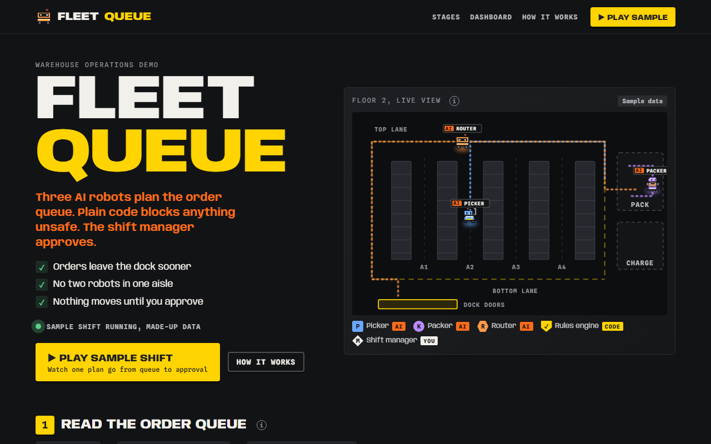

# Fleet Queue

**[Open it live](https://cutify.ghernie.com/examples/fleet-queue/)**

| | |
|---|---|
| Theme | Apron |
| Stack | Plain HTML |
| Data | Made up, and labelled as sample data on the page |

## The brief

Claude was given this brief with the cutify-ui skill installed:

> Fleet Queue, a warehouse operations demo. Three AI agents (Picker, Packer and Router robots) coordinate the order queue, a rules engine (plain code) blocks unsafe plans (aisle congestion, battery level, weight limits), and the shift manager approves the final plan. Apron (dark control-room) theme. Robots visibly move along drawn aisles, with a small before/after dashboard. All numbers are labelled sample data.

## What's on the page

- Pixel robots driving the aisle and lane routes on a floor plan
- Three rules (AISLE-01, BATT-01, WGT-01), each with a plain-English line, that block the first draft
- A before/after dashboard with a hover line chart and a blocks-by-rule bar
- A confirm dialog for the shift manager and a "Play sample" that runs the whole story

## Run it

Open `index.html` in a browser. It's one self-contained file, and only the fonts load from Google Fonts.

Checked in Chromium at 1280px and 375px wide: no overlaps, no sideways scroll, no console errors.
