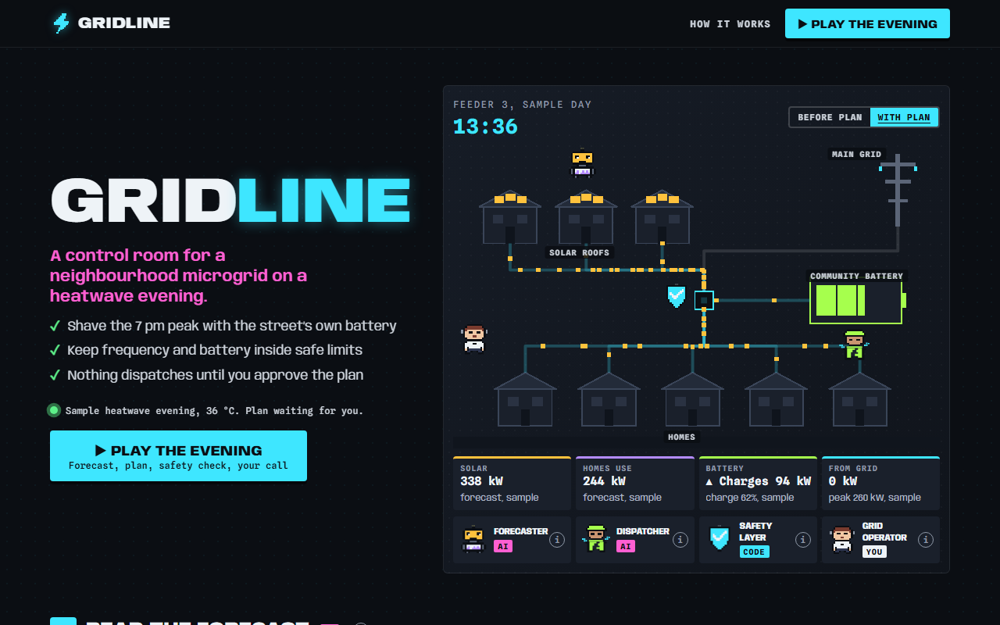

# Gridline

**[Open it live](https://slyf0xx97.github.io/cutify-ui/examples/gridline/)**

| | |
|---|---|
| Theme | Apron, electric palette |
| Stack | Plain HTML |
| Data | Made up, and labelled as sample data on the page |

## The brief

Claude was given this brief with the cutify-ui skill installed:

> Gridline, a control room for a neighbourhood microgrid during a heatwave. Two AI agents: a Forecaster that predicts demand and solar output, and a Dispatcher that decides when the community battery charges and discharges. A safety layer in plain code keeps grid frequency and battery limits. The grid operator approves the evening plan. Animate power flowing along the drawn lines between solar roofs, the battery and houses; show before/after peak load. All numbers labelled sample data.

## What's on the page

- Pixel power packets travelling along the wires, with colour, direction and density following the power
- A looping 12:00 to 23:00 clock and a Before plan / With plan toggle
- Four numbered stages: forecast, battery plan, six safety rules, and the before/after peak (410 to 260 kW, sample)
- Approval in a native confirm dialog

## Run it

Open `index.html` in a browser. It's one self-contained file; only the fonts load from Google Fonts.

Checked in Chromium at 1280px and 375px wide: no overlaps, no sideways scroll, no console errors.
