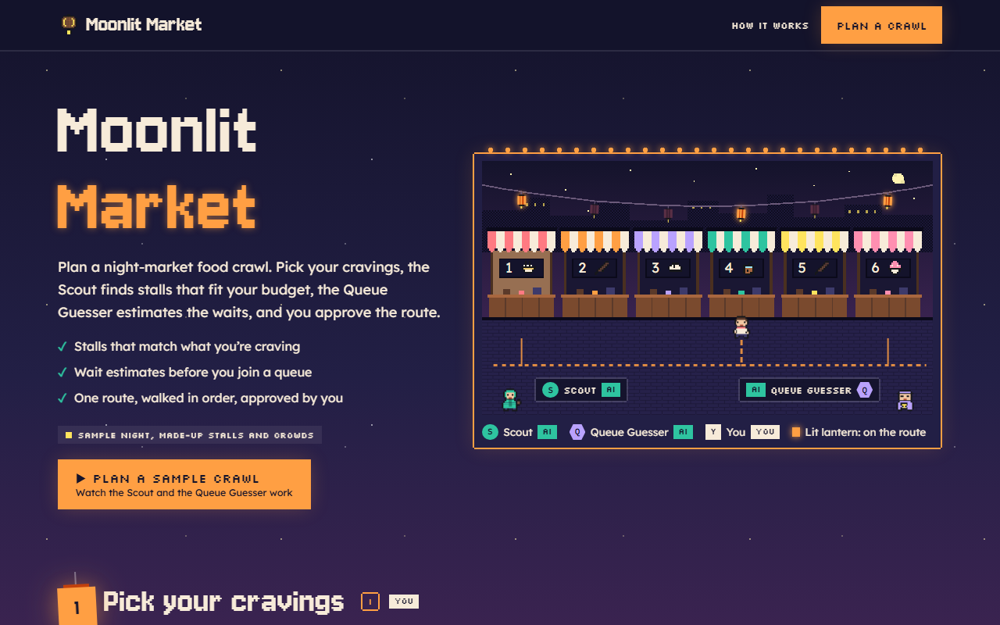

# Moonlit Market

**[Open it live](https://slyf0xx97.github.io/cutify-ui/examples/moonlit-market/)**

| | |
|---|---|
| Theme | Lantern Night |
| Stack | Plain HTML |
| Data | Made up, and labelled as sample data on the page |

## The brief

Claude was given this brief with the cutify-ui skill installed:

> "Moonlit Market", a night-market food crawl planner. Two AI helpers: the Scout, who finds stalls that match your cravings and budget, and the Queue Guesser, who estimates waits from (sample) crowd data. You pick your cravings and approve the crawl route. Lantern Night theme (assets/lantern.css): dusk sky with stars and a dithered skyline, Jersey 10 headings + Silkscreen tags + Lexend body + Sometype Mono, stepped pixel borders, lantern glows, swaying lanterns over stage numbers with the active one lit, typing dots while an agent thinks. Draw a pixel market street of stalls (original art, no real brands) and animate a pixel visitor walking the chosen route with steps() easing. Only this cast; invent nothing else. All data made up and labelled sample.

## What's on the page

- A pixel market street with six made-up stalls, a string of lanterns, a moon and a dithered skyline
- A pixel visitor who walks the route in stepped frames, and each stall lights up as they reach it
- The Scout's picks under your budget and the Queue Guesser's wait estimates, each with typing dots while it thinks
- Stage numbers hung as paper lanterns that sway, with the current stage lit
- Approval in a native dialog, then the visitor walks your route

## Run it

Open `index.html` in a browser. It's one self-contained file; only the fonts load from Google Fonts.

Checked in Chromium at 1280px, 768px and 375px wide: no overlaps, no sideways scroll, no console errors.
