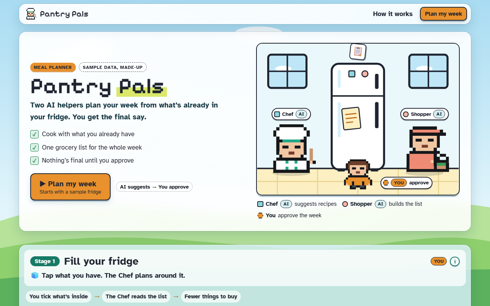

# Pantry Pals



**[Open it live](https://cutify.ghernie.com/examples/pantry-pals/)**

| | |
|---|---|
| Theme | Glass |
| Stack | Next.js App Router (React 19, TypeScript) plus a static copy |
| Data | Made up, and labelled as sample data on the page |

## The brief

Claude was given this brief with the cutify-ui skill installed:

> Pantry Pals, a meal planner. Two AI helpers: a Chef that suggests recipes from what's in your fridge and a Shopper that builds the grocery list. You approve the weekly plan (use the skill's native <dialog> Popup). Glass (light) theme, playful and cute.

## What's on the page

- A kitchen scene where food goes from the fridge to the Chef, the plan to the Shopper and the list to You
- Four numbered stages: fill your fridge, the Chef plans seven dinners, the Shopper builds the list, you approve
- The skill's `PixelSprite`, `Popup`, `StageHeader`, `WordTip` and `KindChip` components
- Passes `tsc --strict` and `next build`

## Run it

```bash
npm install
npm run dev
```

Or open `index.html` directly for the static copy.

Checked in Chromium at 1280px and 375px wide: no overlaps, no sideways scroll, no console errors.
