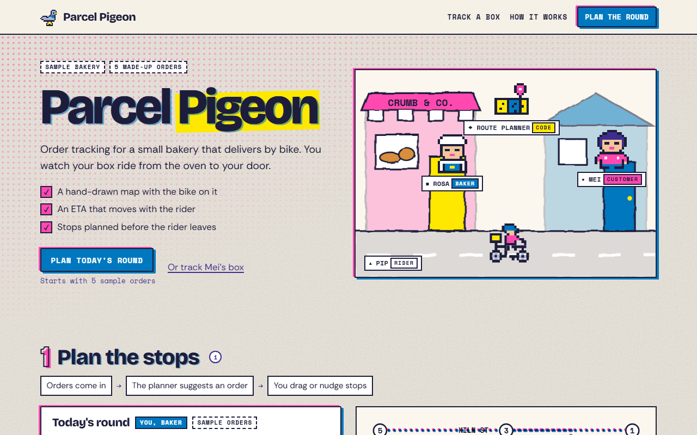

# Parcel Pigeon

**[Open it live](https://cutify.ghernie.com/examples/parcel-pigeon/)**

| | |
|---|---|
| Theme | Riso Club |
| Stack | Plain HTML |
| Data | Made up, and labelled as sample data on the page |

## The brief

Claude was given this brief with the cutify-ui skill installed:

> Parcel Pigeon, order tracking for a small neighbourhood bakery that delivers by bike. The customer sees a hand-drawn map of the neighbourhood with the courier pedalling along the route, a status timeline (baked, boxed, out for delivery, at your door) and an ETA that updates. A route planner suggests the stop order and the baker can drag stops to reorder before the rider leaves. Riso Club theme.

## What's on the page

- A riso street scene with Rosa the baker, Pip the rider on a cargo bike, Mei the customer and the route planner drawn as a folded map
- Five sample orders that the baker can drag, or move with arrow buttons, while the planner offers the nearest-stop-next order and shows how much riding it saves
- A native dialog to send the rider, after which the stop order locks
- Mei's tracking view, with the bike pedalling along a hand-drawn map, the four status steps and an ETA that counts down, plus a Next stop button for reduced motion

## Run it

Open `index.html` in a browser. It's one self-contained file, and only the fonts load from Google Fonts.

Checked in Chromium at 1280px and 375px wide: no overlaps, no sideways scroll, no console errors.
