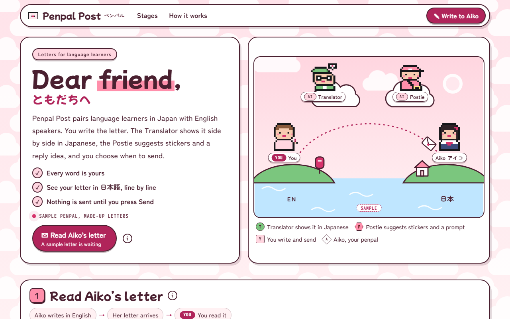

# Penpal Post

**[Open it live](https://cutify.ghernie.com/examples/penpal-post/)**

| | |
|---|---|
| Theme | Custom: Strawberry Milk + Kawaii JP |
| Stack | Plain HTML |
| Data | Made up, and labelled as sample data on the page |

## The brief

Claude was given this brief with the cutify-ui skill installed:

> Penpal Post, a letter-writing app that pairs language learners in Japan and English-speaking countries. Two AI helpers: the Translator, who shows a gentle side-by-side translation of your letter, and the Postie, who suggests stickers and a reply prompt. You write the letter and choose when to send. This is a NEW theme you make by swapping tokens: the Strawberry Milk palette from themes.md, the cloud wallpaper backdrop, the Kawaii JP font pairing (Mochiy Pop One display at ≥20px, Zen Maru Gothic body, M PLUS 1 Code mono), pill buttons, speech-bubble tooltips with one sharp corner (radius 24px 24px 24px 4px), the sticker-wobble micro-interaction on stickers, and a letter that folds into an envelope and flies off when sent (with reduced-motion fallback). Show some Japanese text (kana/kanji) correctly. Only this cast (Translator AI, Postie AI, You, and your penpal Aiko shown as a pixel avatar); invent nothing else. All data and letters made up and labelled sample.

## What's on the page

- A pink sky over the sea, with you and Aiko on two islands and a letter flying along the dotted arc between you
- Aiko's sample letter in English, with a little Japanese (もち, 焼きいも) that has notes on hover
- Your reply in a text box, with one reply idea at a time from the Postie
- The Translator's side-by-side view: each line of your letter with Japanese next to it and a few gentle notes
- Five pixel stickers that wobble on hover, and the Postie marks two of them
- Sending opens a native dialog, then the letter folds into an envelope, gets a heart seal and flies off the screen. Under reduced motion, it shows as sent without the animation

## Run it

Open `index.html` in a browser. It's one self-contained file, and only the fonts load from Google Fonts.

Checked in Chromium at 1280px, 768px and 375px wide: no overlaps, no sideways scroll, no console errors, Japanese glyphs in the right fonts, body text at 4.5:1 or better.
