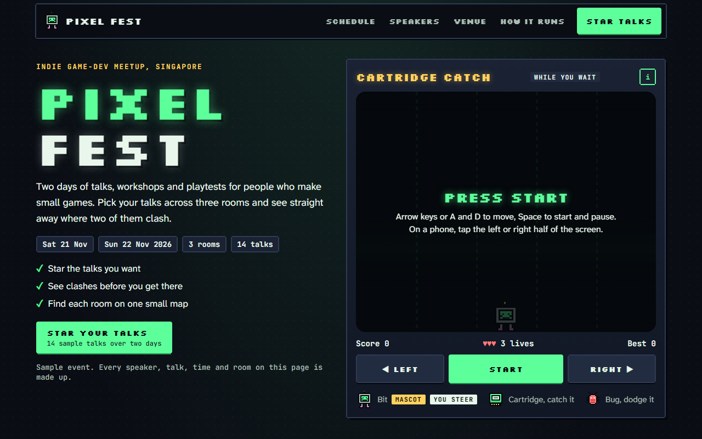

# Pixel Fest

**[Open it live](https://cutify.ghernie.com/examples/pixel-fest/)**

| | |
|---|---|
| Theme | Custom: Arcade Night |
| Stack | Plain HTML |
| Data | Made up, and labelled as sample data on the page |

## The brief

Claude was given this brief with the cutify-ui skill installed:

> Pixel Fest, the website for a two-day indie game-dev meetup in Singapore. A schedule across three rooms where you can star talks and see clashes, speaker cards, a small venue map, and a playable mini-game in the hero while people wait. No AI in the product. Make up a custom theme called Arcade Night: a CRT screen glow, scanlines and chunky 8-bit type, but still easy to read.

## What's on the page

- A hero with Cartridge Catch, a small game where you steer Bit the mascot to catch falling cartridges and dodge bugs, with arrow keys or by tapping either half of the screen
- A two-day schedule with one column per room, where starred talks get a gold edge and two that overlap turn red and name each other
- A plan that lists your starred talks in time order, counts the clashes and lets you unstar one of each pair
- Twelve speaker cards with pixel portraits, each linking to that speaker's talks in the schedule
- A floor plan of the venue where each room shows how many of your starred talks are in it
- Scanlines and a slow flicker on the game screen and the map only, with body text kept plain and sharp
- With reduced motion turned on, the flicker stops and the game switches to step mode, where things only fall when you move

## Run it

Open `index.html` in a browser. It's one self-contained file, and only the fonts load from Google Fonts.

Checked in Chromium at 1280px and 375px wide: no overlaps, no sideways scroll, no console errors.
