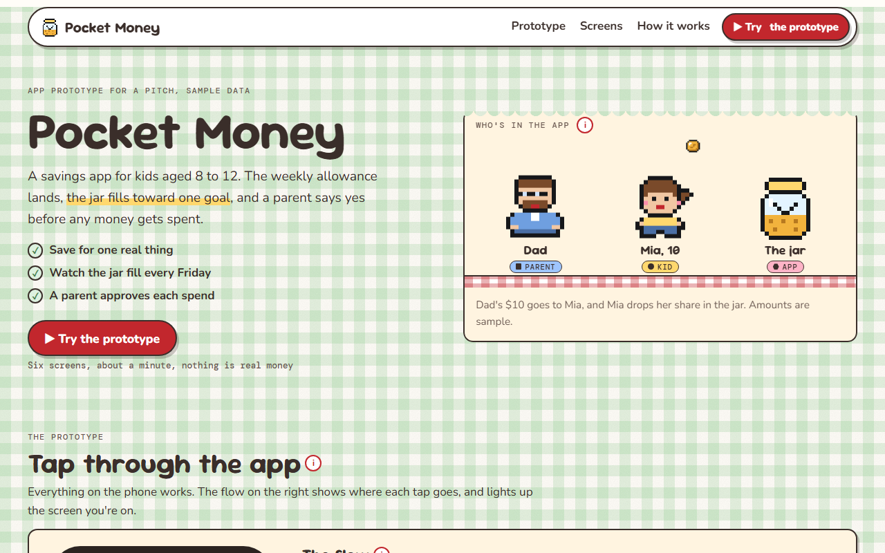

# Pocket Money

**[Open it live](https://cutify.ghernie.com/examples/pocket-money/)**

| | |
|---|---|
| Theme | Picnic, with clover gingham and Sour Gummy headings |
| Stack | Plain HTML |
| Data | Made up, and labelled as sample data on the page |

## The brief

Claude was given this brief with the cutify-ui skill installed:

> Pocket Money, a mobile app prototype that helps kids aged 8 to 12 save their allowance. Show it as a clickable phone prototype on the page: onboarding, setting a savings goal (a new bike), a weekly allowance coming in, and a jar that fills up. A parent approves spending requests. Picnic theme. Make it feel like a real app prototype a designer would show in a pitch, with the screens linked by a little flow diagram.

## What's on the page

- A hero with the cast on a picnic blanket, where a coin hops from Dad to Mia to the jar
- A phone you can tap through: onboarding, a bike goal, Friday's allowance, the jar, a spending request and Dad's approval screen
- A flow diagram of the six screens that lights up where you are and jumps the phone when you tap a box
- Play the flow, which taps through every screen for you, and a switch that outlines every tap area
- The jar fills one pixel step per Friday, and Dad's yes goes through a native dialog
- Six numbered cards with the design reason behind each screen
- How it works, where a coin walks the five steps from Dad's account to the bike

## Run it

Open `index.html` in a browser. It's one self-contained file, and only the fonts load from Google Fonts.

Checked in Chromium at 1280px and 375px wide: no overlaps, no sideways scroll, no console errors.
