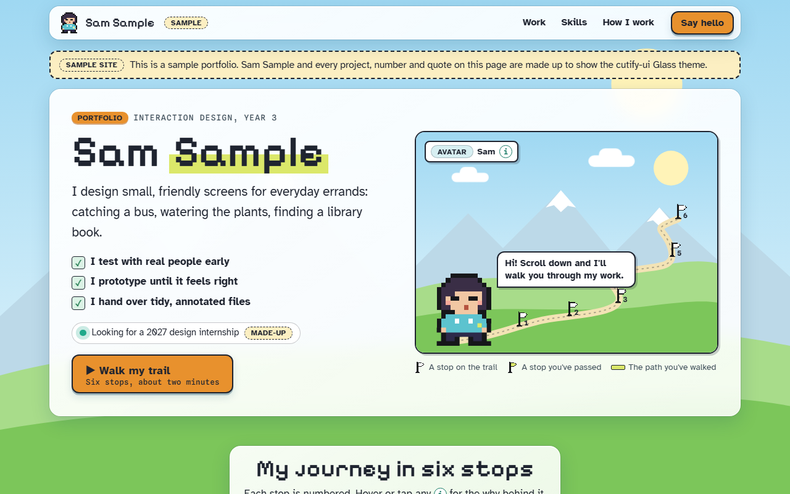

# Mika Tan, portfolio

**[Open it live](https://slyf0xx97.github.io/cutify-ui/examples/portfolio/)**

| | |
|---|---|
| Theme | Glass |
| Stack | Plain HTML |
| Data | Made up, and labelled as sample data on the page |

## The brief

Claude was given this brief with the cutify-ui skill installed:

> A personal portfolio site for "Mika Tan" (a made-up interaction design student). No AI in this product: the cast is Mika's pixel-art avatar as a mascot, and the numbered stages are Mika's journey (About, three case studies, Skills, Contact). The avatar walks a trail as you scroll. Glass (light) theme. Each case study card opens a native <dialog> with details. Clearly mark it as a sample portfolio with made-up projects.

## What's on the page

- A pixel avatar that walks a trail of six flags as you scroll, with stepped walk frames
- Three made-up case studies, each opening in a native dialog
- A "sample site, made up" notice
- Shows the skill works for products with no AI at all

## Run it

Open `index.html` in a browser. It's one self-contained file; only the fonts load from Google Fonts.

Checked in Chromium at 1280px and 375px wide: no overlaps, no sideways scroll, no console errors.
