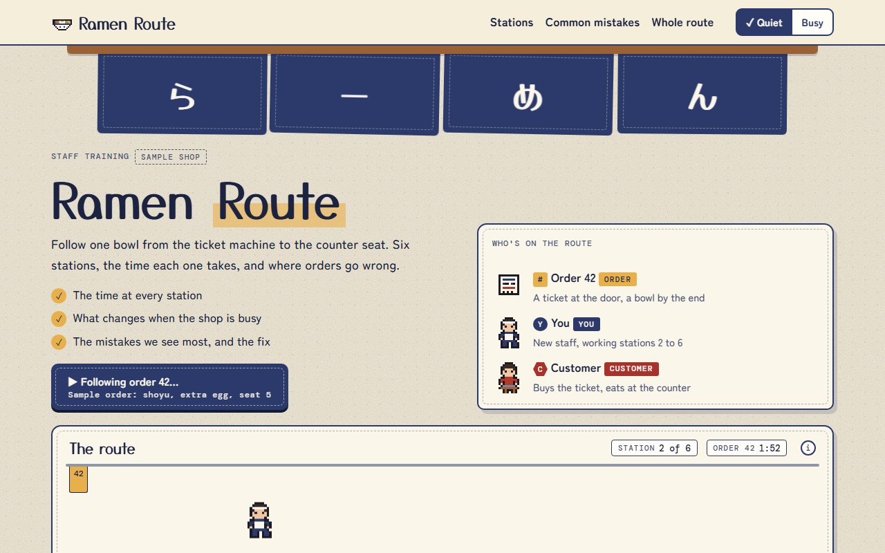

# Ramen Route

**[Open it live](https://cutify.ghernie.com/examples/ramen-route/)**

| | |
|---|---|
| Theme | Custom: Noren |
| Stack | Plain HTML |
| Data | Made up, and labelled as sample data on the page |

## The brief

Claude was given this brief with the cutify-ui skill installed:

> Ramen Route, an animated process flow for training new staff at a small ramen shop. Follow one order from the ticket machine, to the noodle station, broth, toppings and the pass, to the customer's counter seat. Show the timing at each station, what happens when the shop is busy, and where orders usually go wrong. Make up a custom theme called Noren: indigo and cream like a shop curtain, warm and hand-made. No AI, it's a training page.

## What's on the page

- An indigo shop curtain that sways over the title, with cream cloth panels and a running stitch for the Noren theme
- Order 42 walking the counter in pixel steps, from a ticket to a full bowl with steam, while a clock counts its time
- A Quiet and Busy switch that adds tickets to the order rail and changes every station's time
- Six station cards with what to do, the usual mistake and its fix, and what changes at rush hour
- A ranked tally of remade bowls by station, and the whole route drawn as quiet and busy time bars

## Run it

Open `index.html` in a browser. It's one self-contained file, and only the fonts load from Google Fonts.

Checked in Chromium at 1280px and 375px wide: no overlaps, no sideways scroll, no console errors.
