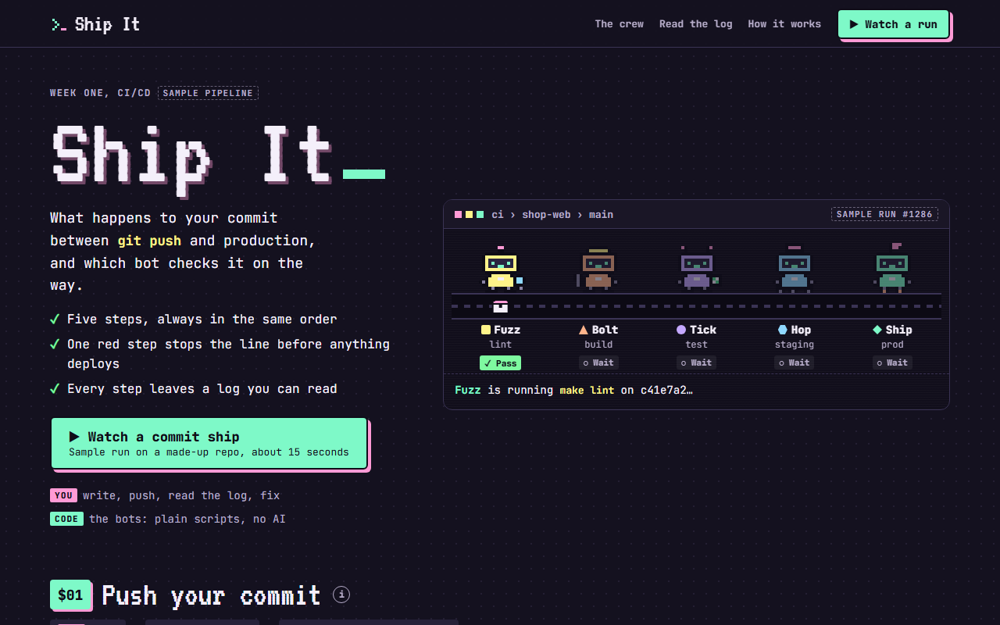

# Ship It

**[Open it live](https://cutify.ghernie.com/examples/ship-it/)**

| | |
|---|---|
| Theme | Custom: Terminal Candy |
| Stack | Plain HTML |
| Data | Made up, and labelled as sample data on the page |

## The brief

Claude was given this brief with the cutify-ui skill installed:

> Ship It, an explainer page for our team's CI/CD pipeline, for new engineers in their first week. Show a commit travelling through lint, build, unit tests, a staging deploy and a production deploy, with a small pixel crew of bots running each step. Include one run where a failing test stops the deploy, and show how to read the logs. No AI agents, it's all plain automation. Make up a custom theme called Terminal Candy: dark, monospace, pastel neon.

## What's on the page

- A pixel parcel riding a conveyor belt past five bots, Fuzz, Bolt, Tick, Hop and Ship, one for each step
- Each bot has its own colour, glyph shape and prop, and the one at work hops while the rest wait
- A red run where one failing unit test stops the line, with staging and production marked as skipped
- A trimmed log of that run with five numbered notes that explain which lines to read and why
- A one-line fix, the local test command, and a second run that goes green all the way to production
- A How it works route with typical times, who does what, and the rules of the line

## Run it

Open `index.html` in a browser. It's one self-contained file, and only the fonts load from Google Fonts.

Checked in Chromium at 1280px and 375px wide: no overlaps, no sideways scroll, no console errors.
