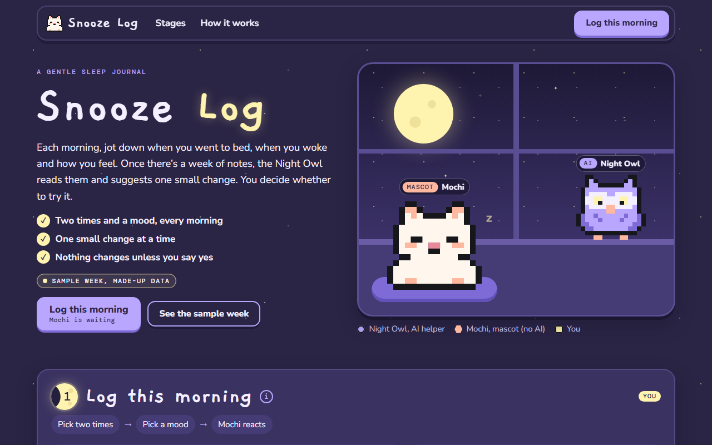

# Snooze Log

**[Open it live](https://slyf0xx97.github.io/cutify-ui/examples/snooze-log/)**

| | |
|---|---|
| Theme | Custom: Sleepy Dusk palette |
| Stack | Plain HTML |
| Data | Made up, and labelled as sample data on the page |

## The brief

Claude was given this brief with the cutify-ui skill installed:

> Snooze Log, a gentle sleep journal. A sleepy pixel cat, Mochi, is the mascot (no AI). One AI helper, the Night Owl, reads your week of (sample) sleep notes and suggests one small change. You log bedtime and mood each morning and decide whether to try the suggestion. This is a NEW theme you make by swapping tokens: the Sleepy Dusk palette from themes.md (dusk #2B2545, cloud #3A3260, lavender #B8A6FF, peach #FFB8A0, star #FFF3B0, ink #F4F0FF), the "dusk with stars" backdrop, the Notebook font pairing (Gaegu 700 for headings at ≥22px, Nunito Sans body, DM Mono), soft rounded cards, and the "idle pet blink" micro-interaction for Mochi (who sleeps more when your sleep is short). A week chart of hours slept (sample), stage numbers as little moons. Only this cast; invent nothing else. All data made up and labelled sample.

## What's on the page

- A bedroom window at night, with the Night Owl on the sill and Mochi curled on a cushion
- Mochi blinks when you slept 7 hours or more, goes drowsy between 6 and 7, and falls asleep under 6, changing as you type your times
- A week chart of hours slept with a tooltip per night, and stage numbers drawn as moons that wax from stage 1 to 4
- The Night Owl reads the six sample notes one by one and suggests one change, which you can try in a native dialog or skip

## Run it

Open `index.html` in a browser. It's one self-contained file, and only the fonts load from Google Fonts.

Checked in Chromium at 1280px, 768px and 375px wide: no overlaps, no sideways scroll, no console errors.
