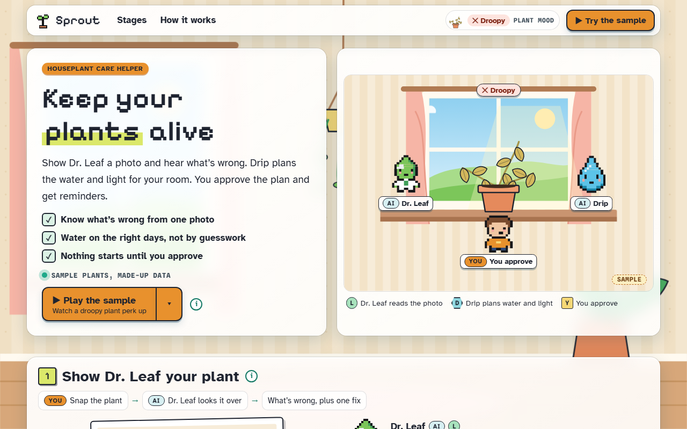

# Sprout

**[Open it live](https://slyf0xx97.github.io/cutify-ui/examples/sprout/)**

| | |
|---|---|
| Theme | Glass |
| Stack | Plain HTML |
| Data | Made up, and labelled as sample data on the page |

## The brief

Claude was given this brief with the cutify-ui skill installed:

> Sprout, a plant-care companion for people who keep killing houseplants. Two AI helpers: Dr. Leaf looks at a photo of a plant and says what's wrong, and Drip plans a watering and light schedule from the plant type and your room. You approve the care plan and get reminders. Glass (light) theme, cosy and cute, with a painted indoor window-sill scene. Animation shows the plant perking up as care happens.

## What's on the page

- A painted room with a window, curtains, a shelf and a hanging planter
- A plant that goes from yellow and droopy to green and upright, one step per stage
- Dr. Leaf's diagnosis with a "how sure" estimate, and Drip's two-week water plan that updates as you change the room
- Approval in a native dialog, then reminders

## Run it

Open `index.html` in a browser. It's one self-contained file; only the fonts load from Google Fonts.

Checked in Chromium at 1280px and 375px wide: no overlaps, no sideways scroll, no console errors.
