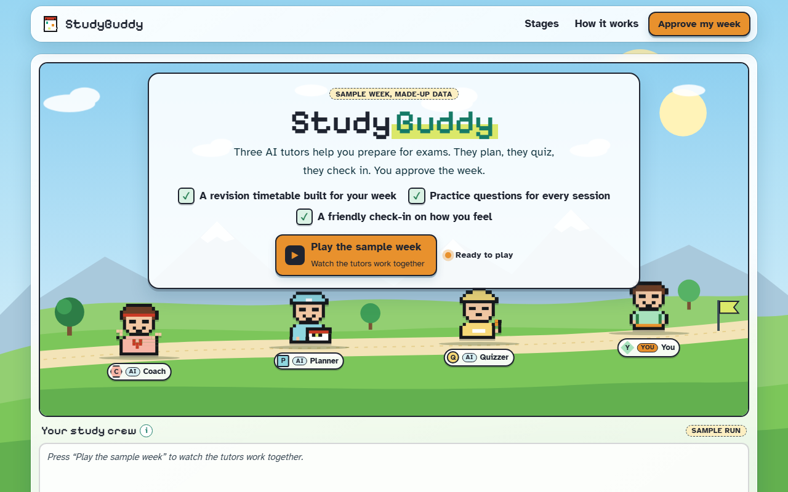

# StudyBuddy

**[Open it live](https://cutify.ghernie.com/examples/studybuddy/)**

| | |
|---|---|
| Theme | Glass |
| Stack | Plain HTML |
| Data | Made up, and labelled as sample data on the page |

## The brief

Claude was given this brief with the cutify-ui skill installed:

> StudyBuddy, an exam-prep app for university students. Three AI tutors: a Planner that builds a revision timetable, a Quizzer that writes practice questions, and a Coach that checks in on your mood. The student approves their weekly plan. Use the Glass (light) theme. A cute, friendly, game-like single-page landing site with animation that shows the tutors working together.

## What's on the page

- Four pixel sprites (Coach, Planner, Quizzer and You), each with its own colour, shape and letter
- A "Play the sample week" run where the tutors take turns and a note passes from Planner to Quizzer to You
- Four numbered stages: pick a mood, see the timetable, answer practice questions, approve the week in a confirm dialog
- A "How it works" route with a moving token and a who-does-what diagram

## Run it

Open `index.html` in a browser. It's one self-contained file, and only the fonts load from Google Fonts.

Checked in Chromium at 1280px and 375px wide: no overlaps, no sideways scroll, no console errors.
