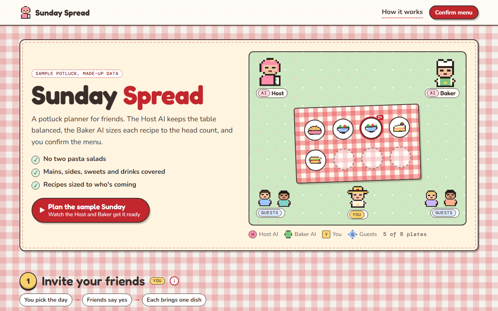

# Sunday Spread

**[Open it live](https://slyf0xx97.github.io/cutify-ui/examples/sunday-spread/)**

| | |
|---|---|
| Theme | Picnic |
| Stack | Plain HTML |
| Data | Made up, and labelled as sample data on the page |

## The brief

Claude was given this brief with the cutify-ui skill installed:

> "Sunday Spread", a potluck planner for friends. Two AI helpers: the Host, who suggests dishes so nothing doubles up and the meal is balanced, and the Baker, who scales recipes to the guest count. Guests claim dishes; you (the organiser) confirm the menu in a native <dialog>, with a confetti micro-interaction (and a reduced-motion fallback). Picnic theme (assets/picnic.css): gingham backdrop, Fredoka + Nunito + DM Mono, jam-jar-lid stage numbers, paper-tag tooltips. Only this cast (Host AI, Baker AI, You, plus guest avatars as simple pixel sprites); invent no other mechanics. Data is made up and labelled as sample.

## What's on the page

- A picnic blanket with eight plate spots that fill in as guests claim dishes, with a red "2×" ring on a double-up
- A guest list you can tick and untick, which sets the head count for the Baker
- The Host's notes on double-ups and empty courses, each with a suggestion you send to a guest, and a plate that flies onto the menu board when they claim it
- The Baker's recipe for each claimed dish, scaled to the head count and rounded to amounts you can buy
- Confirmation in a native dialog, then confetti (a glow ring and a "Menu confirmed" stamp under reduced motion)

## Run it

Open `index.html` in a browser. It's one self-contained file, and only the fonts load from Google Fonts.

Checked in Chromium at 1280px, 768px and 375px wide, and with reduced motion: no overlaps, tooltips stay on screen, the dialog fits, no sideways scroll, no console errors.
