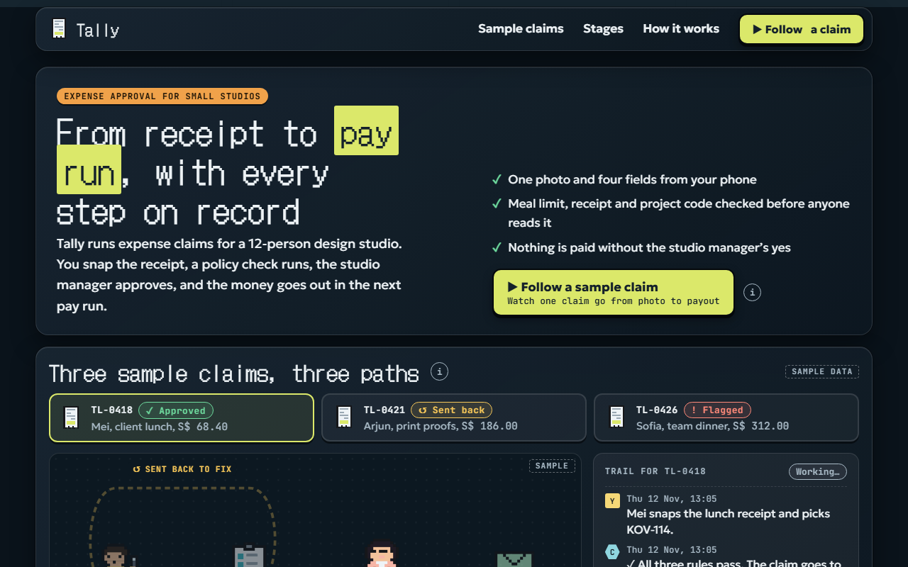

# Tally

**[Open it live](https://cutify.ghernie.com/examples/tally/)**

| | |
|---|---|
| Theme | Glass, dark |
| Stack | Plain HTML |
| Data | Made up, and labelled as sample data on the page |

## The brief

Claude was given this brief with the cutify-ui skill installed:

> Tally, an expense approval tool for a 12-person design studio. Map the process flow from snapping a receipt, to an automatic policy check (meal limit, missing receipt, wrong project code), to the studio manager's approval, to the payout in the next pay run. Show three sample claims taking different paths, one approved, one sent back, one flagged. Glass theme in dark mode. It should look like a polished B2B product page that a finance lead would trust.

## What's on the page

- A painted studio at night behind dark frosted glass, with the city lit up through the windows
- A process map with four stations: the claimant, the policy check, Priya the studio manager and the pay run
- Three sample claims you can pick. A receipt walks each one's path and a trail fills in with times and who did what
- The approved lunch goes all the way to the pay run, the print job with a wrong project code loops back to the claimant, and the dinner over the meal limit stops in a held bay
- The three policy rules in plain words, with each claim's result per rule
- Priya's queue, where you decide the flagged dinner in a native dialog: pay up to the limit, pay in full as an exception, or send it back
- A sample pay run that updates with your decision, and a short list of what Tally never does

## Run it

Open `index.html` in a browser. It's one self-contained file, and only the fonts load from Google Fonts.

Checked in Chromium at 1280px and 375px wide: no overlaps, no sideways scroll, no console errors.
