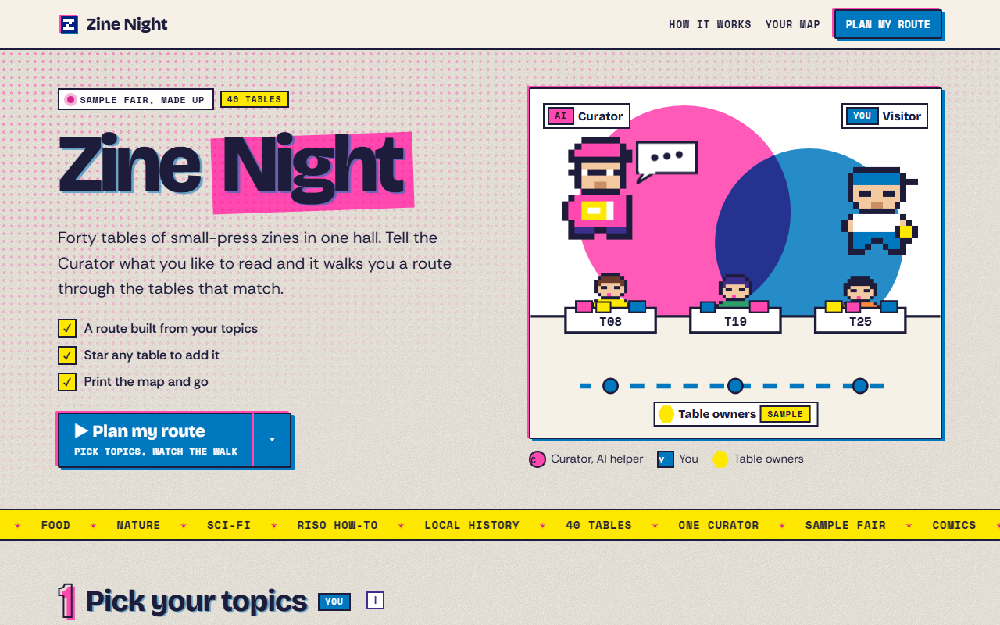

# Zine Night

**[Open it live](https://slyf0xx97.github.io/cutify-ui/examples/zine-night/)**

| | |
|---|---|
| Theme | Riso Club |
| Stack | Plain HTML |
| Data | Made up, and labelled as sample data on the page |

## The brief

Claude was given this brief with the cutify-ui skill installed:

> "Zine Night", the page for a (made-up) indie zine fair with 40 tables. One AI helper, the Curator, builds a walking route through the tables from the topics you like; you star tables and approve your route, then get a printable map. Riso Club theme (assets/riso.css): newsprint + grain backdrop with a pink halftone fade behind the hero, Bricolage Grotesque + Rethink Sans + Space Mono, misregistered pink/blue double shadows, outlined stage numbers, a marquee strip divider, overprint (multiply) effects. Draw the fair floor as an SVG map and animate the route drawing itself (self-drawing line) and a pixel visitor walking it. Only this cast (Curator AI, You, simple pixel table-owner sprites); invent nothing else. All data made up and labelled sample.

## What's on the page

- A riso poster hero with the Curator, you and three table owners over pink and blue circles that overprint to purple
- An SVG floor map of 40 tables where the route draws itself while a pixel visitor walks it and stops at each table
- Table owners who hop as you reach them, and tables you can star from the map or the stop list
- Approval in a native dialog, then a one-page walk sheet that prints on its own

## Run it

Open `index.html` in a browser. It's one self-contained file, and only the fonts load from Google Fonts.

Checked in Chromium at 1280px, 768px and 375px wide: no overlaps, no sideways scroll, no console errors.
